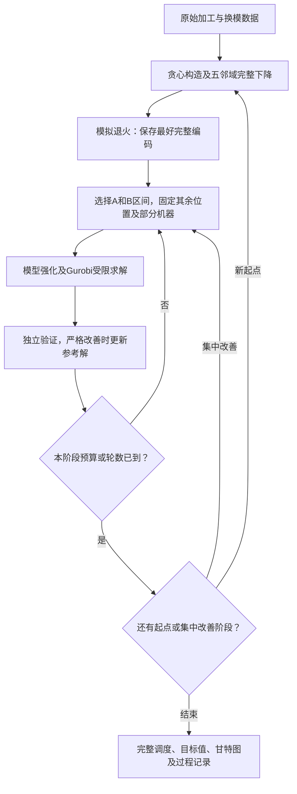
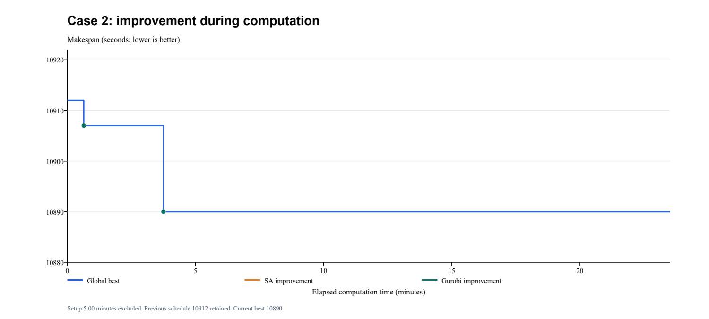

# 综合实验题目2算法设计

2026-10-25更新：一阶段独立最好可行值10465，两核40分钟档，完整350工序核验；[公开成果与复现](../published/stage1_10465/README.md)。项目历史二阶段10454仍更低，正式默认未切换。详见§6.19与§8.4。

> 文档定位：用于课程报告、算法说明及代码复核，区分当前实现、已经完成的实验与待验证研究方案。
> 更新日期：2026 年 10 月 14 日。
> 当前实现：贪心构造与完整局部下降 → 模拟退火 → Gurobi 局部精确重排。
> 方案状态：课程项目正式方案已确定，保留退火及现有区间搜索，结束本轮算法扩展实验；详见§8.3。
> 编制依据：[问题2.pdf](../../问题2.pdf)、[问题2数据.xlsx](../../问题2数据.xlsx)和项目当前实现。
> 结果状态：Case 1 的全局最优值已证明为 **5031 秒**；Case 2 当前最好可行值为 **10702 秒**，来自宽度9的受限精确重排，尚未证明全局最优。历史10847、10890试跑保持原记录。

仓库保留代码、测试、文字说明及筛选后的实验报告、汇总和过程记录，另保留Case 1的5031秒调度与Case 2的10702秒调度。原始PDF、Excel、历史源码快照、逐轮模型及其他大部分完整调度不收录。本文指向未收录文件的链接用于本机归档复核；未另行取得原始输入和完整归档时，不能重放全部历史证明。历史结果、求解器版本与测试计数是已完成实验的记录，不等于下载仓库后已经重跑验证。运行所需文件和当前命令见[运行说明](../README.md)，其他材料见[文档索引](README.md)。

公开仓库本次同步一阶段必要共用接口、候选弧基础模块、宽度上限及过程记录兼容测试；候选默认关闭，10465未使用候选约束。其他研究入口、测试和完整历史快照仍可能仅在本机，不能把历史本机测试计数当成公开源码本次验证。

本文不改变题目调度规则。遗传算法、禁忌搜索和变邻域搜索的历史入口仍保留，正式一阶段仍采用模拟退火；已有同预算对照尚未说明退火是必需步骤。第4.11节区分早期只读统计与新候选接口，第6节记录各次实测；独立试验结果不能当作正式默认流程的性能。

## 1. 问题描述与算法框架

### 1.1 问题描述

若干工件依次经过工位1至10。工位1～5及7～10各有一台机器，工位6有两台并行机器。所有工件时刻0已经到达生产线，工位间转移时间为0，缓冲区容量足够大，每道工序必须一次完成。

工位1～5采用共同排列 $A$；工位6可重新选择机器及队内顺序；工位6的实际完工先后决定工位7～10的共同排列 $B$。同时从工位6完成的工件可任选相对顺序，但后续四个工位须一致。

相邻工件从 $i$ 换到 $j$ 的换模时间为 $s_{ij}$，有方向且与机器无关。换模占用机器，并且必须在后一个工件到达之后开始。每条机器队列的首件换模时间为0。

输入与目标如下。

| 内容 | 定义 |
| --- | --- |
| 加工时间 | Excel表2，工件×工位；工位6给出6-1时长 |
| 换模时间 | Excel表4，前工件×后工件；两个维度为同一组工件 |
| 6-2加工时长 | 6-1时长乘1.2，再四舍五入取整 |
| Case 1 | 7个工件，70道工序 |
| Case 2 | 35个工件，350道工序 |
| 目标 | 最小化最后一个工件在工位10完成的时刻 $C_{\max}$ |

系统首件在工位1从0开始，因此目标等价于整个生产过程的时间跨度。总完工时间之和、等待时间、换模时间之和不作为替代目标。换模矩阵的对角元在实际调度中不会被查询。

### 1.2 为什么采用混合方法

单次解码较快，可以用启发式评价大量完整调度；完整混合整数线性规划（MILP，即同时含连续时间变量和0/1顺序变量的线性模型）能够证明最优，但Case 2完整模型的求解困难。

本项目希望利用启发式产生完整可行解及用于缩小搜索范围的信息，再由求解器联合优化保留下来的顺序、机器归属和时间。评价启发式时，应同时检查其自身目标值和对后续求解的帮助，不能只看退火下降了多少。

当前已经实现的主要限制方式是区间重排：先用贪心与退火得到完整可行解，暂时固定区间外顺序及部分机器归属，再更换区间继续搜索。此类方法属于大邻域搜索，即保留部分决策、重新优化其余决策。固定依据主要是区间位置。候选相邻集合已做独立实验，但当前规则存在排除更好调度的受限最优证据，未显示整体收益，不替换现有流程；后续研究重点为区间宽度、选择和时间分配。

两种计算的分工如下。

| 阶段 | 决定的内容 | 输出给下一阶段 |
| --- | --- | --- |
| 贪心及局部下降 | 构造完整编码，检查五种邻域的严格改善 | 一个局部最优编码及完整目标值 |
| 模拟退火 | 通过交换、插入、换机器探索不同顺序 | 所有已评价编码中的最好可行编码 |
| 局部Gurobi | 在本轮固定条件下优化允许变化的排列、归属和时间 | 经验证的改善调度，或保留原参考解 |

精确阶段得到的是本轮受限问题的结果。全局最优证明只用于小规模Case 1的完整模型，Case 2以可行性、解质量和实际耗时评价。




## 2. 符号体系与编码

### 2.1 集合、参数和时间

| 符号 | 含义 |
| --- | --- |
| $J=\{1,\ldots,n\}$ | 工件集合；代码使用0至$n-1$索引 |
| $k\in\{1,\ldots,10\}$ | 工位编号 |
| $p_{jk}$ | 工件$j$在工位$k$的加工时间；$p_{j6}$为6-1时长 |
| $p_{j6m}$ | 工件$j$在工位6机器$m$上的时长 |
| $s_{ij}$ | 前工件$i$换到后工件$j$的换模时间 |
| $R_{jk}$ | 到达工位$k$的时刻，$R_{j1}=0$，其余为$C_{j,k-1}$ |
| $S_{jk},C_{jk}$ | 加工开始、完成时刻；加工开始前还可能需要换模 |
| $C_{\max}$ | 全部工件在工位10的最晚完成时刻 |

正整数加工时间的换算统一使用：

$$p_{j,6,2}=\left\lfloor\frac{12p_{j6}+5}{10}\right\rfloor.$$

代码为 `(12 * p + 5) // 10`，避免使用银行家舍入。

### 2.2 三数组编码

一个解表示为：

$$\chi=(A,B,m).$$

- $A$：工位1～5的共同排列。
- $B$：期望实现的工位6完工全序，也是工位7～10的共同排列。
- $m_j$：工件$j$的工位6机器归属；代码中0表示6-1、1表示6-2。

两个排列必须各包含全部工件恰一次。机器数组按工件编号存储，不能随着排列位置移动。工位6队列由 $B$ 按机器归属过滤得到：

$$Q_r=[j\in B:m_j=r],\quad r\in\{0,1\}.$$

例如：

```text
A = [J1, J2, J3, J4]
B = [J3, J1, J4, J2]
m = [0, 1, 1, 0]  # 分别对应J1、J2、J3、J4
Q6-1 = [J1, J4]
Q6-2 = [J3, J2]
```

这里的 $B$ 不允许独立于工位6的时间表随意指定。解码必须安排必要的等待，使实际完工时刻按 $B$ 非降序。它不是“算完工位6后再任意重排工位7”。

类定义见 [encoding.py](../common/encoding.py) 的 `Chromosome`。编码只存离散决策，时间表由同一解码过程计算。

### 2.3 编码长度与完整组合数

编码有$3n$个数组元素，不是$3n$个二进制位。两个排列各有$n!$种选择，按工件编号的机器数组有$2^n$种，因此理论离散编码数为：

$$N(n)=(n!)^2 2^n.$$

| 算例 | 编码数组元素数 | 理论完整编码数 |
| --- | ---: | ---: |
| Case 1，7工件 | 21 | 3,251,404,800 |
| Case 2，35工件 | 105 | 约$3.669\times10^{90}$ |

不同编码可能产生相同目标值。连续等待时间通过解码或模型时间变量处理，不作为额外排列枚举。当前完整精确模型的二进制变量数是$5n^2+5n+2$，Case 2为6302；这些变量受路径、机器归属和时间约束联动，不能把$2^{6302}$当作有效编码数量。$\binom{35}{3}=6545$只表示选择三个自由工件的局部范围数，不是完整搜索规模。Gurobi使用约束、下界和剪枝，实际用时不能从上述组合数直接换算。

## 3. 解码、评分与数学模型

### 3.1 一般换模约束

若工件$i$是$j$在当前机器上的紧邻前驱，则原题要求：

$$S_{jk}\ge\max(C_{ik},R_{jk})+s_{ij},\qquad C_{jk}=S_{jk}+p_{jkm}.$$

无前驱时，换模时间为0。不能写为 $\max(R_{jk},C_{ik}+s_{ij})$，否则会允许在$j$到达前换模。

原题允许开始时刻晚于这个下界。特别是在工位6，继续等待会改变完工顺序，进而改变后段相邻换模。因此完整精确模型保留不等式。

### 3.2 前段解码：工位1～5

依次处理五个工位，每个工位按 $A$ 遍历全部工件。设$j$在$A$中的前驱为$i$，计算：

$$S_{jk}=\max(C_{ik},C_{j,k-1})+s_{ij},\qquad C_{jk}=S_{jk}+p_{jk}.$$

工位1的到达时刻取0；队列首件的机器可用时间及换模时间取0。计算工位5后得到每个工件到达工位6的时刻。

### 3.3 工位6解码：机器队列与完工排序

按 $B$ 遍历。对当前工件$j$，记：

- $i$为其所属工位6队列的紧邻前驱；无前驱时对应完工时间和换模取0。
- $b^-$为$j$在全序$B$中的前一个工件；首件对应完工时间取0。
- $p_{j6m_j}$为选定机器的加工时长。

先算不考虑另一机器完工排序的最早完成时刻：

$$E_j=\max(C_{i6},C_{j5})+s_{ij}+p_{j6m_j}.$$

再满足全序 $B$：

$$C_{j6}=\max(E_j,C_{b^-6}),\qquad S_{j6}=C_{j6}-p_{j6m_j}.$$

若 $E_j<C_{b^-6}$，则延后$j$的加工开始，使其不早于前一个$B$工件完成。每道工序仍连续加工、没有拆分；两台机器可以同时加工，也允许同时完成。

例如，某工件到达时刻100，同机前驱完成时刻90，换模10，加工20，则 $E_j=130$。如果$B$前一个工件完成于150，则本工件开始于130、完成于150，换模可安排在120～130，仍不早于到达和同机前驱完成。这个等待由编码中的完工顺序决定。

### 3.4 后段解码：工位7～10

工位7的到达时刻为 $C_{j6}$，工位8～10的到达时刻为上一工位完成时刻。四个工位均按 $B$ 使用与前段相同的换模递推。

评分只取：

$$f(\chi)=C_{\max}(\chi)=\max_{j\in J}C_{j,10}.$$

值越小，编码越好。所有合法编码均可解码为可行调度，因此不需要用罚分补偿缺工件、重叠加工或不满足完工顺序的方案。搜索操作必须首先保持编码合法。

`evaluate()`仅返回目标值，`decode()`输出完整时间表，两者调用同一个 `_calculate()`，不会使用两套时间公式。

### 3.5 为什么可以不编码连续等待时间

固定 $(A,B,m)$ 后，上述递推给出这些离散选择下的最早可行调度：每个时间只依赖已经计算的工位前驱、机器前驱及$B$完工前驱，并对相应下界取最大值。

对任意具有相同 $(A,B,m)$ 的可行时间表，按递推顺序归纳，可知该时间表的各完成时间均不早于解码所得时间。加工开始推迟不会降低后续工序的这些下界，因此解码不会增大目标。

反过来，原题任意可行调度都可提取 $A$、机器归属和一个与工位6完工时刻一致的全序 $B$，同机队列顺序也必然与该全序一致。解码该编码所得目标不大于原调度目标。因此编码空间至少包含一个原题全局最优调度，不必额外用浮点基因表达任意等待。

这是编码表达能力的说明，不意味着启发式能找到全局最优。

### 3.6 求解器中的变量与约束

局部求解使用与完整模型相同的调度规则，增加本轮的固定条件。核心变量如下。

| 变量 | 类型 | 含义 |
| --- | --- | --- |
| $S_{jk},C_{jk}$ | 连续非负 | 开始与完成时刻 |
| $x_{jr}$ | 0/1或固定常数 | 工位6机器归属，$x_{j0}+x_{j1}=1$ |
| $z^q_{ij}$ | 0/1或固定常数 | 队列$q\in\{A,B,6\text{-}1,6\text{-}2\}$中$i$紧邻$j$ |
| $u^A_{ij},u^B_{ij}$ | 0/1或固定常数 | 两工件的前后关系，用于加强排列约束 |
| $\operatorname{pos}^q_j$ | 连续，范围$[0,n-1]$ | A或B中的位置，用于排除循环并约束先后 |
| $C_{\max}$ | 连续非负 | 最终完成时间，目标最小化 |

虚拟起点和终点表示队首、队尾。A、B中每个工件恰有一个前驱和后继；工位6队列的入度、出度等于该机器的归属变量，允许空队列。正加工时长的时间约束和位置约束排除子回路。

当弧$i\to j$被选中，机器约束与到达约束分别为：

$$S_{jk}\ge C_{ik}+s_{ij}-M^{\rm machine}_{ijk}(1-z^q_{ij}),$$
$$S_{jk}\ge C_{j,k-1}+s_{ij}-M^{\rm arrival}_{ijk}(1-z^q_{ij})\quad(k>1).$$

B相邻弧还满足：

$$C_{j6}\ge C_{i6}-M^{\rm order}_{ij}(1-z^B_{ij}).$$

这些约束共同保证不可提前换模和实际完工顺序。两两先后约束不额外添加换模时间，只有紧邻弧才产生对应换模，避免重复计费。时间变量仍满足不等式，不强制所有工序立即开工。

完整模型及进一步公式见 [Case1精确模型](Case1精确模型.md)；实际构建函数为 [solver.py](../common/solver.py) 的 `build_model()`，局部入口复用该函数。

## 4. 算法设计与求解流程

### 4.1 贪心构造

先按每个工件十道工序的加工时间之和降序建立优先列表。工位6初始机器归属按当前累计加工负荷及各机器加工时长选择，暂不将这个负荷估计作为最终评分。

随后分两步插入：

1. 构造A：逐件试插已构造前缀的所有位置，未插入的工件保留在尾部；暂取B=A，按完整十工位目标选位置。
2. 构造B及机器归属：A固定，逐件试插B前缀所有位置，同时尝试两台工位6机器，按完整目标选取。

构造过程中每个候选始终包含全部工件，不以只有前缀的生产时间评分。默认构造8次：第一次确定性选择，之后随机打乱优先列表，且以25%概率从最好三个插入候选中随机选一个，以产生不同起点。

当前实现为 [construction.py](../stage1/construction.py) 的 `balanced_code()`、`greedy_construct()`；历史遗传入口仍保留，不作为正式构造函数的定义位置。

### 4.2 完整局部下降

每个构造解检查五种邻域：A插入、B插入、机器归属翻转、A交换、B交换。

一个邻域内完整评价所有移动，接受严格改善最大的候选；一旦改善，重新从第一个邻域检查。只有连续检查五种邻域均无严格改善才结束。因此初始解相对于这五种单次移动是局部最优，而不是只运行几次贪心移动后结束。

构造中曾经评价过的最好编码也进行完整下降，再从全部下降结果中选最好者。邻域下降定义在 [local_search.py](../common/local_search.py)，正式初始化为 [construction.py](../stage1/construction.py) 的 `initialize()`；Case 2默认使用保持相同接受规则的批量评分下降，第5.7节说明其计算方式。

### 4.3 模拟退火

模拟退火保存当前接受解和历史最好解。每次从上述五种邻域的全部具体操作中等概率抽一个操作；这不等于先等概率选择五种邻域，因为各邻域的操作数量不同。

设当前值$f$、候选值$f'$，$\Delta=f'-f$。接受规则为：

$$P(\text{接受})=\begin{cases}1,&\Delta\le0,\\\exp(-\Delta/T),&\Delta>0.\end{cases}$$

接受较差解用于离开当前局部最优。最终返回所有已评价编码中的最好者，不返回最后一个接受解。历史最好值只能不增，当前解可以上下波动。

初温由当前初始解的至多64个随机邻居校准，取正增量的中位数$d$：

$$T_{\rm cal}=\frac{d}{-\ln(0.8)}.$$

没有正增量时取1。当前正式入口 `problem2.stage1.main` 默认 $T_0=2T_{\rm cal}$，每层1000次移动，降温 $T\leftarrow0.97T$，终温 $10^{-4}T_{\rm cal}$，完成全部降温时约326层。中位正增量在初始温度的接受概率约89.4%。单次退火默认最多90秒，同时受含初始化的总预算限制；先达到温度或时间条件者结束。

早期普通研究入口使用倍率1、降温0.95；历史30分钟试跑使用倍率2、降温0.97。参数按对应源码快照解释，不能用早期默认值描述当前正式入口。

### 4.4 给Gurobi提供的数据

每轮输入包含以下内容，不只是一个目标上界。

| 数据 | 用途 |
| --- | --- |
| 所有工件加工时间、方向换模矩阵 | 构造完整十工位时间约束 |
| 当前参考编码及完整调度 | 为时间、机器归属、相邻弧及目标变量设置MIP start，提供可行初始解 |
| 已验证的可行值$H$ | 约束$C_{\max}\le H$并推导时间界 |
| 本轮A、B区间及区间外先后关系 | 固定区间外位置，限制本轮允许改变的排列 |
| 可换机器工件集合 | 固定其他工件的工位6机器归属 |
| 单轮预算、线程数与模型强化选项 | 控制本轮计算并记录证据 |

MIP start用于帮助求解器找到可行上界，不固定变量；缩小搜索范围的是额外的顺序与机器归属条件。

### 4.5 局部精确重排的范围

在当前参考排列A、B上各选择长度$w$的连续区间，得到工件集合$F_A,F_B$。

- A中只有$F_A$内工件之间的先后可以改变；其他成对先后沿用参考解。
- B中只有$F_B$内工件之间的先后可以改变；其他成对先后沿用参考解。
- $F_A\cup F_B$内工件允许换工位6机器；其他归属固定。
- 全部工件的十工位时间仍参与模型，不将区间外工件删除，也不固定它们的开始时间。

把区间外工件与所有工件的相对顺序固定后，其位置也保持不变，区间内工件留在原区间重排。例：A=[J1,J2,J3,J4,J5]，打开[J2,J3,J4]，允许[J1,J4,J2,J3,J5]，本轮不允许J2移到J1前。

每轮从当前最好解重新建立这些条件。换区间后，上一轮的固定关系不会残留，所以某工件在本轮不能动，并不表示后续轮次一直不能动。

当前参考解满足本轮限制，始终可行。得到严格改善且验证通过才更新最好解；超时或无改善则保留参考解。即使求解器超时，只要有经验证的更好可行解也可接受。

这里“精确重排”指使用精确数学模型，不表示每轮限时调用均求到最优。只有达到OPTIMAL，才证明该轮固定范围内最优。全体35个工件、350道工序仍在模型中，区间外工件的排队和时间可以随区间内调整而变化。

若改善要求跨出本轮区间，本轮就无法直接找到。重叠区间可以逐步移动工件，但若中间步骤必须先变差或保持原目标值，严格改善接受规则会阻断这条路径。编码本身能表示跨区间排列，限制来自本轮固定条件和接受规则；更换、扩大区间也不保证最终覆盖全局最优。

### 4.6 区间选择与扩大

区间选择轮换三种方式：

1. 从最终完成工序反向检查取等号的时间依赖，优先选择涉及较多相关工件的区间。
2. 若有多个较好搜索样本，优先选择顺序或机器归属分歧较大的区间。
3. 按固定随机种子选择尚未尝试的区间，扩大覆盖。

反向检查保留同时起作用的多个依赖，权重仅用于选择区间。当前正式一阶段给 `refine_windows()` 的分歧数据为空，第二种方式的分数全为0，实际按同分随机规则选择；退火记录没有自动用于固定关系或选择区间。相关记录筛选目前属于独立实验，不把正式入口的结果解释为这些统计发挥了作用。

默认宽度5。连续6轮没有改善且最近3轮均达到受限OPTIMAL时，宽度增加2；Case 2上限9，Case 1上限6。超时且未改善时，宽度大于3则减2。相同参考编码、宽度、两个区间起点的组合在同一精确阶段内不重复。

当前正式一阶段精确阶段默认最多110秒、单轮5秒、最多80轮；总预算默认600秒，包含初始化和退火。早期 `research_main` 的120秒、36轮属于另一入口。单轮求解前再次计算剩余时间，建模后再缩短Gurobi的TimeLimit。建模、验证及导出仍可能产生额外耗时，因此记录实际用时，不承诺严格秒级截止。这是有限预算的搜索，不保证检查完全部区间，也不宣称达到全部这些邻域的局部最优；第6.7节的完整范围检查是独立实验。

### 4.7 为什么不永久固定“搜索中没改变”的关系

关系没改变可能来自较差移动、没有充分尝试、接受概率或搜索起点，并不能证明其在所有更好解中必须保持。

早期Case 1试验中，固定稳定关系后的某些模型已证明受限最优5063，而原题最优5031，说明这些附加限制确实排除了所有5031解。正式区间流程只临时固定当前区间外的关系，并不断更换、扩大允许变化的位置。

最近Case 2记录筛选也发现具体反例：按95%样本一致率和至少20次近优试探筛出的J6机器固定条件，排除了保存的10951编码；J11固定条件排除了保存的11079编码。单个工件改变机器后的完整候选较差，不能推出它与其他机器变化、顺序重排结合后仍较差。第6.10节说明证据范围，当前未采用这些记录固定条件作为正式默认规则。

相关代码为 [neighborhoods.py](../stage1/neighborhoods.py) 的 `window_constraints()`、`choose_window()`和 [windows.py](../stage1/windows.py) 的 `refine_windows()`。

### 4.8 总体伪代码

下列伪代码合并说明单起点与可选多起点安排。正式一阶段只执行一个起点，范围缓存默认关闭；启用缓存或使用长时间入口时，才执行相应可选分支。第4.11节的候选集合不在当前流程中。

```text
读取并检查原始加工时间、方向换模时间
按工件编号计算6-2时长
全局最好解 ← 空
可选：建立本次运行共用的已证明范围缓存
for 每个规定起点:
    初始解 ← 多次贪心构造并逐个完成五邻域下降
              或读取并验证已有参考解；可选复用首次新构造的编码
    若初始化达到总截止时间，返回已评价最好完整编码并标注下降未完成
    退火最好解 ← 模拟退火(初始解)
    当前解 ← 退火最好解
    for 每轮局部精确搜索，直到阶段预算/轮数耗尽:
        在当前A、B上选择两个区间
        按当前解固定区间外先后及部分机器归属
        删除不可能的相邻弧，推导必选弧和时间界
        用当前完整调度设置MIP start，令Cmax ≤ 当前可行值
        若输入、规则、参考编码、固定条件及上界与已证明范围一致:
            复用已验证结果，记录原MPS证明目录
        否则:
            调用Gurobi，保留模型、状态、上下界和耗时
            仅在受限OPTIMAL且上下界一致、调度验证通过时保存证明
        if 有严格更好的完整可行调度且独立验证通过:
            当前解 ← 从该调度提取的编码
        按结果调整区间宽度，下一轮重新建立限制
    更新全局最好解
可选：从全局最好解继续若干段局部精确搜索
解码并验证最终解，输出完整调度、甘特图、过程记录
```

### 4.9 范围缓存、初始化复用与截止时间

[exact_cache.py](../common/exact_cache.py)的`ExactCache`由调用入口持有，长时间入口在起点和集中阶段之间共用同一个实例。缓存键包含加工及换模数据、编码和模型源码摘要、参考编码、固定条件及目标上界。条件的证据标签不改变数学范围，不参与匹配；模型精简和强化必须保持相同可行范围，命中记录同时保存原证明参数和本次请求参数。

仅复用受限OPTIMAL、状态为2、上下界与调度目标在容差内一致且独立验证通过的结果。超时范围只记录为未完成，不列入证明缓存。命中后再次验证调度、固定条件和原MPS哈希，输出原证明目录；求解运行时间记为0，验证、哈希及导出仍计入实际耗时。原受限下界只对应原固定范围，不变成原题下界或全局证明。缓存只在本次进程中保留，不自动导入历史结果。

`long_budget --reuse-initialization`是可选策略：第一条仍使用提供的参考解，后续新构造一次，再复用该构造编码并改变退火种子。每次退火保存自己的最好结果，全局最好值独立保留。没有开启时仍按种子重新构造。当前数据的多次构造曾得到相同编码，但不能据此保证其他数据或种子也相同。

`initialize(..., deadline=...)`在完整编码评分之间检查停止。截止时返回已评价的最好完整编码，`complete=False`且不列出已完成的局部最优邻域；不能将其称为完成五邻域下降。未传截止时间的Case 1四算法初始化仍完成原下降规则。退火校准也检查截止时间；各精确阶段接收同一个绝对截止时间，在区间选择后和建模后重新计算剩余时间。长时间入口使用单调时钟计量运行耗时，并保留末尾导出预留时间。这些检查减少明显超支，但不会强行中断正在运行的Python建模和文件导出。

已有证据见[最初隔离对照](../results/design_validation/run01/实验记录.md)和[正式实现及后续策略研究](../results/search_improvement/run01/实验记录.md)。等目标值编码、两工件远距离插入及单工件完整枚举仍保留为实验程序，当前正式流程不自动采用它们。

### 4.10 前后段联合重排及少量自由工件求解

单件移动很快，但可能无法同时调整两段顺序和机器。新的`joint_main`在同一个参考编码上选择少量工件，分两种范围搜索。

第一种范围直接枚举：从A、B各移出所选k个工件，将它们分别作为连续的一组插入任意位置，遍历组内排列和2^k种机器归属。其他工件的相对顺序、机器归属保持；两段插入位置和组内顺序独立选择。枚举空间附加了连续要求，**不是原题约束**。若原参考解的所选工件不连续，仍把原参考解作为额外候选保留，确保不会因本轮限制退步。

第二种范围交给Gurobi：只固定未选工件的A、B相对顺序及机器归属，所选工件可以分别任意插入、改变机器。没有固定未选工件的位置或时间，时间变量保持一般模型不等式，后段顺序仍满足工位6完工全序。该范围包含原参考解以及第一种范围中的全部编码。仅放开2～4个工件，禁止退化为Case 2完整模型。

组选择使用解码所得时间依赖：某道工序的完成时间直接决定后继最早时间，且延后会延后最终完成时，它位于关键路径；具体权重由`neighborhoods.critical_weights`计算。优先检查涉及关键工序较大换模时间的组，并覆盖A、B现有连续组，再补其他组合。这里只决定检查顺序，不推断关系必然正确，不遍历全部35选3组合。新入口默认每个参考解检查80组，每32组无改善后尝试一次Gurobi，发现改善后重新计数；总求解次数默认3次，每次最多120秒，全部受总预算约束。早期对照使用12组，具体版本与参数另记。

发现严格改善就更新参考解、重新选组；完整枚举过的同一参考解与同一组不重复计算，未完成的枚举不作证明。精确缓存仍只保存已证明范围。下一次精确调用前须有新枚举，范围耗尽后转入扰动，不连续用完剩余求解轮数。精确模型从全程最好解出发，只有改善该值才更新当前参考；无改善时保留扰动后的探索路径。可选`--explore`在停滞后从最好解扰动，再作完整局部下降，允许较差的局部最优成为参考；全程最好值独立保留。一次运行已经从较差参考找到10847，但尚无多次稳定性证据，仍显式开启。

35工件的三件成组枚举范围含313632个编码，一轮可以完整检查。已有实测由10890改善到10875，随后更宽的三自由工件Gurobi范围改善到10862；第二次改善后所选工件没有保持连续，说明第二种范围有实际作用。10875也位于旧流程最后9个位置的区间范围内，因此旧流程停滞不能仅归因于区间宽度，还与选哪个区间、有限求解时间有关。

### 4.11 从启发式结果生成候选相邻工件：独立研究接口

本节保留2026年10月13日接口实现前的只读统计，并说明新增的候选相邻接口。`common/candidate_arcs.py`、`common/solver.py`及`common/solver_utils.py`已支持候选集合，独立入口为`experiments.sa_candidate_main`。正式一阶段仍按§4.5生成区间限制，没有采用候选集合。研究目标是利用启发式缩小Gurobi可选的相邻关系，同时允许工件跨越原来的连续区间。以下三种子合并统计属于早期研究，不能当作随后单种子试验的实际模型规模。

统计输入为最近约束实验的三个种子23、53、71所保存的完整编码，分别保留目标值不超过该种子最好值1.03倍的样本。合并、去重后有3259个完整编码，其中前段排列2335种、后段排列275种、机器归属数组703种。统计时没有用10702等历史好解来选择候选；历史解只用于事后检查候选是否会排除已有改善。

对A、B、6-1、6-2分别统计实际相邻工件$i\to j$。35个工件每条队列最多有$35\times34=1190$条有向工件弧，不包含虚拟起点、终点和自身到自身的弧。三个种子的全部样本中，出现过的弧数如下。

| 队列 | A | B | 6-1 | 6-2 |
| --- | --- | --- | --- | --- |
| 全部样本出现过的工件弧 | 627 | 343 | 362 | 352 |

这些记录有利用价值，但不能把“没出现过”直接判定为不应出现。例如，已保存的10702编码在四条队列中分别需要2、6、3、5条未出现过的弧；即使允许所有已观察弧，也会排除这个编码。10951的局部改善编码在A、B没有缺失弧，但两条工位6队列仍分别缺1、2条。这里检查的是具体编码，不能据此推断同一目标值的全部其他编码也被排除。

进一步按每条队列的不同完整排列去重，每种排列对相邻频数贡献一次。对每个工件取频数最高的k个候选前驱及k个候选后继，求并集，再补入同一个10952参考编码的全部实际工件弧。频数相同时按有方向的换模时间、工件编号排序。这是本次统计规则，尚不是正式搜索规则。

| k | A弧数 | B弧数 | 6-1弧数 | 6-2弧数 | 粗估模型0/1变量数 |
| --- | --- | --- | --- | --- | --- |
| 3 | 134 | 133 | 136 | 135 | 2080 |
| 5 | 221 | 201 | 208 | 198 | 2370 |
| 7 | 300 | 261 | 272 | 265 | 2640 |

粗估保留全部虚拟起终点弧、机器归属变量和完工先后变量，仅减去未选的实际工件弧，未构建模型或继续推导常数。它只能说明可能减少变量，不能当作求解时间预测。前驱和后继候选取并集后，每个工件的可选数量也不一定恰为k。

上述小集合仍会排除已有改善。例如k=7时，10702编码在四条队列分别缺4、8、4、8条弧。三个种子合并后，每个工件都曾被分配到两台机器，没有可据全体样本一致意见直接固定的单个工件归属。10702的机器数组与703种已观察数组中最近的一种仍差7个工件；因此，仅允许历史完整机器数组或其一两次翻转，也会排除这个已知编码。

只补充低换模弧同样不充分：在A、B的全部已观察弧中，加入每个工件换模最短的7个前驱、7个后继后，10702编码仍分别缺1、2条弧。例如它使用A中的J25→J1，换模81秒；在J25的后继中该换模时间排第28。单独看换模较长，不能认定它不适合完整十工位调度。

历史候选方案的数学含义是：对队列q建立允许弧集合$E_q$，仅令不在集合中的相邻变量$z^q_{ij}=0$。出现频数高只提高候选优先级，不令其必选。所有限制从同一个已验证参考解生成，保留参考解的四条队列弧、队首和队尾；工位6空队列仍须允许。所有工件的十道工序、工位6机器选择及实际完工排序约束保持。

与区间限制不同，这种方案不按原位置固定跨区间先后；若允许弧能构成所需新排列，就可能产生远距离移动。但任何未允许的弧仍会限制搜索范围。应先用较小候选集合求解，无改善时扩大集合，并保留最好可行解；不能把某次受限OPTIMAL当作候选已覆盖原题最优解的证明。机器归属暂不按单次翻转的表现永久固定，多个工件联合改变的反例见§6.10。

验证应先检查参考解能否保留、历史改善编码缺哪些弧，再与区间方案逐种子比较。计时须包括退火记录、候选生成、建模、求解、验证与导出；报告每次最终目标及首次找到时间。当前只读统计说明启发式结果能提供候选排序，也说明过早删去未观察关系会丢失已知改善，尚不能证明新方案优于现有区间求解。

#### 4.11.1 已实现的单种子候选规则

每个种子只使用自己的`constraint_generation/run02/prefix_seed*/tracking.json`，合并其中的`front_samples`与`other_samples`完整编码，核查每条样本的完整评分，并保留不超过本次参考值1.03倍的编码。记录最好编码必须与`sa_start_full/run01/seed*/reference/result.json`逐项一致；不一致则报错，不替换起点。

`generate_candidates()`对A、B、6-1、6-2分别按不同队列排列去重。实际工件弧只从正频数关系中选：每件取最多5个前驱和5个后继，取并集，再补入同一个参考编码的全部实际工件弧；同频数按有方向换模时间、工件编号排序。前驱与后继并集后某件可能有超过5个可选关系，不能描述为每件恰好5个选项。全部虚拟起终点弧均允许，6-1、6-2均允许空队列。

`build_model(..., candidate_arcs=...)`不创建集合之外的相邻变量，提取调度时缺失变量仍按0读取。候选弧没有被强制取1，也没有按样本一致率固定机器归属或两两先后；A、B可跨位置重排，不包含连续区间条件。但两条工位6队列的相邻限制可能间接排除某些机器组合，因此不是原题完整范围。全部十工位的时间约束、加工时长、到达后换模、工位6等待和完工排序保持原公式。结果始终记`scope=restricted`，OPTIMAL只对应本次候选集合。

候选参数默认是`None`，原调用方不传入时保留完整或原受限模型行为。小实例按全部288种编码筛选候选范围并与求解器对照；默认完整模型与修改前MPS逐字节一致。Case 2试验还逐种子只建模、不优化默认完整模型，与本聊天已保存基线MPS核对，防止把接口改动当作算法性能差异。

本次只检查固定k=5，不因无改善自动增加k；更大候选或解除全部限制仍是后续独立实验。保留参考解仅保证不会退步，不能保证保留其他更好的解。比较主要看最终目标及包括读取、生成、建模和导出的实际时间，受限下界与完整模型全局下界不互比。

#### 4.11.2 增加被拒绝的近优完整编码

原`ConstraintObserver`只保存已接受编码与新的最好编码，拒绝候选没有保留完整编码。独立`experiments/candidate_trial_records.py`在原样本之外记录被拒绝且目标不超过当时最好值1.03倍的完整编码，完成后按最终最好值再筛选，不按数量截断。它不重复评分、不调用随机数；下一次尝试或最终报告时确定上一候选是否被接受。原接受样本及其截断规则保持，候选仍由同一`generate_candidates()`按各队列不同排列去重、k=5生成。扩展样本可能改变频数排名，加入新弧时也可能移除旧弧，不应称为单纯扩大旧集合。

独立入口`python -B -m problem2.experiments.sa_candidate_trials --output 新目录 --end-utc 带时区的未来截止时间`先核对原记录和扩展记录的全部尝试编码、评分与接受结果摘要，并核查原样本与历史相同；不一致则保留诊断、不求解。每个种子最多180秒、8线程，仍无区间与直接机器固定，scope=restricted，正式默认流程不采用。完整时间及历史准备成本分别报告，结果见§6.12。

#### 4.11.3 用退火分歧选择区间

独立`experiments/annealing_window_evidence.py`从同种子扩展退火记录筛选目标不超过该退火最好值1.03倍的完整编码。A、B分别按不同排列去重，机器按不同归属数组去重；固定该样本集。对每一对工件计算样本顺序与当前参考解不同的比例，对各工件计算样本机器与当前不同的比例；参考解严格改善后重新比较，分歧不是某次改变有利的证明。

沿用`choose_window()`的得分与三轮循环：每个工件累计它参与的两两顺序分歧，并把机器分歧计入A、B，区间内求和。只有每三轮的第二轮unstable使用实测分歧；critical和random保持原样。基线传空分歧，unstable轮同分随机选择。两组使用同一`window_constraints()`、宽度调整和严格改善接受规则；不叠加候选弧、不从样本额外固定机器或先后。所有限制来自当轮参考解及选中区间，scope=restricted。

独立入口`python -B -m problem2.experiments.sa_guided_windows --output 新目录 --end-utc 带时区的未来截止时间`运行三个种子的两组新对照，每组180秒追加预算包含读取、统计、选择、建模、求解、核查和导出，每轮最多5秒、8线程，初始宽度5、自动调整、compact=True、复用环境、关闭范围缓存。实验上限5000轮使时间决定终止，正式默认入口的80轮上限及空分歧输入均未修改。数据准备的历史时间单列，不宣称新端到端同预算实验。结果见§6.13。

#### 4.11.4 提供字段与顺序权重对照

`WindowEvidence.from_report(..., fields=..., normalize_order=...)`允许只提供A顺序、B顺序、机器归属或三类混合。省略参数时保留原三类直接相加行为。每组仍核查全部完整编码评分，使用同种子最好值1.03倍的同一合格样本集；仅计算需要的统计，A/B分别按不同排列、机器按不同数组去重，费用计入追加预算。

原每个工件的顺序贡献最多包含n-1项0～1分歧，机器仅一项0～1分歧。显式归一化时把每项顺序分歧除以max(1,n-1)，35工件即除以34，使每件每段的顺序总贡献不超过1，机器不变。省略参数不改变原数据结构、分歧、选择及随机数调用。只在每三轮的unstable轮提供选定字段，critical/random不变；改善后与新的参考解比较，不追加候选弧或从样本直接固定关系。

独立入口`python -B -m problem2.experiments.sa_record_components --output 新目录 --end-utc 带时区的未来截止时间`运行无记录、仅A、仅B、仅机器、三类直接相加、三类顺序归一化六组，种子23/53/71各180秒追加预算。每轮5秒、8线程，初始宽度5并按原规则调整，复用环境、compact=True、关闭缓存；实验上限5000轮、预留3秒尾部核查。三种子按预先固定循环移位顺序执行，不根据结果改参数。正式默认流程不采用，结果见§6.14。

#### 4.11.5 完整过程记录与区间、候选弧联合对照

`run_annealing(..., process=None)`提供可选完整过程回调。独立`experiments/annealing_trace.py`按完整编码去重编号、使用标准库gzip保存每次校准及正式尝试。记录修改前后编码、操作类型和位置、温度、目标变化、原有随机接受值、接受结果、最好值、评价与缓存次数；不增加随机数调用或评分。默认关闭。固定次数下与修改前函数核查轨迹，全部编码重新评分并重放操作、接受和缓存；按时间停止时另报告记录开销，不能声称同一秒数仍尝试相同次数。

`process_evidence.py`定义七条规则：全部近优、已接受近优、被拒绝近优、最后30%尝试的近优、最好值1.01倍以内、按重复次数加权，以及使当前目标下降的候选按相对改善幅度加权。除1.01组外质量门槛为本种子最终退火最好值1.03倍；校准保存但不投票，Gurobi改善后不改变历史筛选门槛。普通组按各队列不同排列及机器数组去重；重复和改善组保留权重。改善组按该操作类型的全部尝试次数除权，统计对象为完整候选，不证明单独一条关系导致改善。空样本回退为无历史选择、全部相邻弧允许。

同一统计可用于原每三轮的中间轮区间选择，或生成相邻候选。选区间时A/B顺序贡献除以n-1，机器贡献不变，不直接固定关系。候选只禁止集合外实际工件弧，全部虚拟起终点及空工位6队列允许，不直接固定机器；机器组合可能被间接排除。k=5与k=10集合有包含关系。频数由纯退火记录固定，每轮补入当前参考编码实际弧，不能将旧记录直接以改善后的参考值重新调用旧生成函数。

`refine_windows(..., candidate_provider=None)`允许独立试验每轮提供候选；默认None保持原模型范围和流程。候选模式禁止范围缓存，因为旧缓存键没有候选集合。每轮验证参考、固定条件、候选及全部工序；结果scope=restricted。小实例全288编码与区间、候选交集穷举对照。新规则不进入正式默认流程。

本次获确认的12小时实验从北京时间2026-10-13 21:44:42起，固定截止2026-10-14 09:44:42。独立入口`python -B -m problem2.experiments.sa_process_experiment`自动完成记录准备、固定区间诊断、15组探索、八新种子四组复核、四新种子较长预算比较及报告。输出[sa_complete_process/run01](../results/sa_complete_process/run01/实验记录.md)，测试及小实例证据[sa_complete_process_gate/run01](../results/sa_complete_process_gate/run01/verification.json)。执行状态以保存文件为准，不能将尚未完成的计划写成结果。

训练种子23/53/71/1009/1013/1019，独立复核种子2026101401～2026101408，最后比较种子2026101501～2026101504；各种子重新初始化并从自己的纯退火最好编码出发，不使用已有10702或历史改善编码。固定区间每宽度5/7/9取关键工件及随机区间各一对，同一参考、区间、初始解及参数比较基线与七规则×两k，单模型5秒，基线首尾轮换。基线编码只用于事后排除检查，不回填候选。强度按训练范围平均目标差、已证明损失数量、实际耗时比和较大k顺序选择。

探索15组×六种子×120秒；复核基线、最佳选区间、最佳候选、两者结合×八新种子×300秒；最后两组×四新种子×450秒。选组按与同种子基线的目标差除退火起点所得中位数、均值、退步数、最差退步及标签排序，后续种子不回调规则。每组包括读取、统计、建模、求解、逐轮核验和导出，预留10秒尾部；记录真实超时。初始化、原函数对照、新记录和重放成本分别报告，共享准备不称免费或按组数摊薄。上界只来自本组可行参考，受限gap/下界不跨范围比较。

程序串行执行，检查源码和原始输入SHA-256，拒绝覆盖，保存完整模型、日志、调度、源快照、统计、逐轮选择及检查点。11小时后不新开实验，保留最终核验报告；任一验证失败不带问题继续，父进程限制单工作耗时并保留失败诊断。临时阻止系统自动睡眠，进程结束释放，不改持久电源设置。未安排服务器、提交、推送或预算外继续运行。

#### 4.11.6 分离工位6候选限制的独立对照

`ProcessEvidence.candidate(reference, k, restricted_queues=None)`允许指定受限队列。省略参数仍使用A、B、6-1、6-2四队列原候选；指定`('A', 'B')`时前后段候选保持相同，工位6的所有实际相邻弧均允许。每轮仍补入当前参考编码的受限队列弧；虚拟起点、终点、空队列和时间不等式保持原规则。区间本身固定的关系及部分机器归属仍在，只撤去工位6候选集合造成的额外限制，不把工位6改为最早就绪立即开工。

独立入口`python -B -m problem2.experiments.sa_m6_candidate_ablation`比较原区间、仅A/B候选、四队列候选。候选沿用all_near与k=5，各组复用本种子相同纯退火编码；新种子2026101601～2026101604，组顺序循环移位，不根据结果调整。每组最多60秒，读取、频数统计、建模、逐轮核验和导出均计入；预留10秒尾部工作，每轮Gurobi最多5秒、8线程，初始宽度5、自适应宽度、缓存关闭。初始化、完整退火记录和全部编码重放费用另报；并不声称重新运行纯无记录退火完成了同一秒数的工作。

三工件288个完整编码用于接口穷举，四个小模型核对区间与候选交集范围，默认模型和允许全部弧模型的MPS完全相同。正式默认入口没有启用该选项。具体新种子结果见§6.16。

#### 4.11.7 五类信息全因子试验

独立模块`information_factors.py`使用频数、完整方案质量、温度阶段、接受状态、实际关系变化与操作效果五个开关；所有32个组合均测试，未把单因素平均无效的字段预先删除。记录池包含初始、全部校准和正式尝试前后编码，不按1.03硬筛选。频数按不同队列排列统计；质量取本种子退火最好值/当前完整编码目标值；阶段取0.25+0.75×正式尝试进度；接受/拒绝权重为1/0.5，缺失阶段或接受字段为中性1。质量、阶段、接受的乘积先在同条记录内计算再平均，不能把总体均值相乘后冒称联合信息。

实际效果只对真正增删的关系统计：新增弧取clip((移动前目标−移动后目标)/(0.01×移动前目标),−1,1)，删除弧取相反符号，未变化弧不记操作效果。变化仍是完整操作效果的关联，不宣称每条弧独立造成改善。开启实际效果时按变化记录平均，关闭时按完整状态中的关系平均；所有开关使用已冻结的相同映射，无信息组按有方向换模时间及工件编号排序。排序分数保留12位小数消除浮点汇总末位差异。

每条队列候选实际弧恰为min(350,n(n−1))，补入同一当前参考编码的全部实际弧后再填满预算；虚拟起终点和空队列保持可选。候选数量相同不等于固定区间模型剩余变量数相同，弧出现位置也是信息改变模型的方式。基线仅为原区间，另设同密度随机弧及全部信息关闭对照。全部350工序、主动等待与工位6实际完工排序保持一般模型原约束。

入口`python -B -m problem2.experiments.sa_information_doe`先以六个已有种子、每种子四个固定范围（宽5、9各两处）测试32组合及两对照，共24×34=816模型，每模型总预算5秒、求解器至多3秒、8线程，顺序预先随机化。全部24个范围完成后才按预定义门槛选择完整组合；`information_analysis.py`计算全部31个因子/交互效应，包括10个三因素交互。种子是统计重复单位，区间在种子内平均，不把数百万次退火尝试当独立样本。

选中三类及以下信息时，新种子复核全部子组合加原区间；选四/五类时确认完整组合、逐项删除、全关和原区间，不声称新种子复核所有子组合。各组90秒；原区间与全部信息关闭组不扣退火统计费用，使用信息的候选组先扣本接口读取完整记录并统计的实际成本，再扣10秒末尾预留；历史准备与新记录生成/重放成本单列，共享不称免费。筛选没有组合同时优于原区间、全关及随机对照，则按确认方案提前停止。探索置信区间不当作多重比较校正后的确认结论，10秒小效应可能证据不足。

本次于北京时间2026年10月14日11:04:43开始，固定上限17:04:43；实现、测试、统计、求解、核验和报告均在六小时内。149项单元测试和68个三工件模型门禁通过，逐范围与288个完整编码穷举一致；两参考解包含空工位6队列，默认与全部弧模型MPS相同。正式入口未采用新规则。运行产物见`results/sa_information_doe/run02`（保留run01及source_earlier检查点），完成后按保存证据更新实验结论，不因用户要求有结果而虚构正面收益。

### 4.12 条件精修二阶段（2026-10-30独立研究配置）

读取并完整验证参考编码，分别维护当前搜索解与全程最好。每轮冻结开始时最好目标，按5/7/9轮换扰动任意位置工件，所选工件联合插入重建后，对全体工件下降。仅当下降候选不大于冻结目标时进行宽5/7/9精修；即使跳过，候选仍进入原外层较差接受。

精修后若任何已完整评分编码刷新全程最好，则当前解转到最好；否则按3%限幅、相对当前的增量和温度接受候选。连续6轮未刷新全程最好则当前回最好并重置温度。最好值独立保存，窗口最优只属于当轮附加限制。算法不使用外部10407等数值作停止或选窗条件。此规则对应[公开入口](../published/stage2_10335/README.md)，不改变原二阶段main默认；具体参数、六份对照和成本见§6.20。

## 5. Python实现、模型强化与复杂度

### 5.1 模块与功能对应

实现分为五个目录：`common/`为数据、编码解码、评分缓存、模型、验证及导出；`stage1/`为构造、退火、区间重排和独立运行入口；`stage2/`为联合重排、扰动及并行起点；`tests/`集中单元与集成测试；`experiments/`保留对照和早期方法。贪心与退火已从原遗传及四算法对照模块拆出，核心函数与参数规则保持；旧入口仅作模块转发。

一阶段独立命令：`python -B -m problem2.stage1.main --case 2 --seed 2026101114 --seconds 600 --output problem2/results/stage1_new`。二阶段可通过`--reference`读取其`final/result.json`继续搜索，分别报告两阶段实际耗时。


| 模块 | 作用 |
| --- | --- |
| [data.py](../common/data.py) | 只读加载两算例及统一的6-2取整 |
| [encoding.py](../common/encoding.py) | 编码校验、完整评分、完整调度解码 |
| [exact_cache.py](../common/exact_cache.py) | 已证明固定范围的跨阶段缓存与原MPS证据检查 |
| [evaluator.py](../common/evaluator.py) | 完整编码评分缓存、最好解和搜索结果记录 |
| [construction.py](../stage1/construction.py) | 贪心构造、完整局部下降及初始解选择 |
| [local_search.py](../common/local_search.py) | 五种移动及完整局部下降 |
| [annealing.py](../stage1/annealing.py) | 温度校准、随机移动及退火接受 |
| [stable_constraints.py](../common/stable_constraints.py) | 固定决策代入、弧排除与推导 |
| [time_bounds.py](../common/time_bounds.py) | 根据必须满足的时间条件推导上下界 |
| [solver.py](../common/solver.py) | 完整/受限MILP共用模型和Case 1精确入口 |
| [solver_utils.py](../common/solver_utils.py) | 一次受限求解、调度验证与证据保存 |
| [export.py](../common/export.py) | JSON、CSV及甘特图导出 |
| [windows.py](../stage1/windows.py) | 局部区间选择、约束生成及求解轮换 |
| [一阶段入口](../stage1/main.py) | 从原始输入构造、退火及区间精确求解 |
| [联合重排](../stage2/joint_search.py) | 多工件成组枚举和自由插入范围 |
| [二阶段入口](../stage2/main.py) | 已有解上的联合重排、扰动和局部求解 |
| [并行入口](../stage2/multistart.py) | 不同起点的独立进程搜索 |
| [four_methods.py](../experiments/four_methods.py) | 历史四算法对照，共用正式构造和退火函数 |
| [long_budget.py](../stage1/multistart_budget.py) | 多起点、总预算、实时记录及集中改善 |
| [exact_validation.py](../common/validation.py) | 不依赖解码递推的完整调度验证 |
| [audit_research.py](../experiments/audit_research.py) | 核对保存的模型、调度、源码及输入哈希 |

### 5.2 删除不可能的弧并代入固定决策

固定先后若已推出$i$在$k$前、$k$在$j$前，则A或B中$i\to j$不可能紧邻，可以不创建该变量。对于工位6，还必须确认中间工件$k$属于同一机器，才可以这样排除。

固定机器和先后可直接代入0/1常数。必加工节点若只剩一个可行前驱或后继，由入度、出度约束可推导必选弧，继续排除冲突。所有推导只能来自本轮条件，不能因为参考解采用某条弧就认定其必选。

当前使用位集合进行相同的弧筛选。它改变计算方式，筛选结果与旧实现逐项一致。

### 5.3 时间上下界与Big-M

用已经验证的可行值$H$限定搜索$C_{\max}\le H$，只排除更差的解。先利用各工件剩余加工时长建立基本时间界，再把必须满足的条件写成：

$$t_v\ge t_u+d_{uv}.$$

条件包括加工、工位转移、固定机器先后、固定相邻及B完工排序。向前递推下界，从$H$向后递推上界。只有确定相邻时才加入该换模时长；机器尚未确定时，工位6下界使用较快机器时长。

例如相邻约束采用：

$$M^{\rm machine}_{ijk}=\max\{0,UB(C_{ik})+s_{ij}-LB(S_{jk})\}.$$

当弧为0时，变量上下界保证约束不再限制时间；为1时恢复正确的换模条件。到达约束和完工排序按对应变量界作相同推导。不使用无依据的巨大常数。

### 5.4 重复调用的成本

每轮仍构建独立模型并调用Gurobi。共用求解器环境不复用上一轮模型或分支树；其环境创建成本较小，不能据此宣称大量提速。当前正式一阶段固定使用环境共用，早期研究入口用`--reuse-env`显式选择。

模型精简省略已由变量界保证成立的约束，保留有作用的固定方向时间约束。它不改变应保留的可行范围，但有限时间内求解器的搜索路径可能不同。三次早期对照中模型更快，最终质量有好有坏。当前正式一阶段固定使用`compact=True`；早期研究入口用`--compact-model`显式开启，历史长时间试跑采用部分开启、部分关闭。

计时必须包含模型构建、求解、验证和导出。单轮`TimeLimit`只限制求解器计算，不等于整轮墙钟时间。

### 5.5 复杂度

| 操作 | 当前实现的主要成本 |
| --- | --- |
| 单个编码评分 | $O(10n)$时间，$O(n)$辅助空间 |
| 完整解码 | $O(10n)$时间，$O(10n)$时间表及输出空间 |
| 一次贪心插入构造 | $O(n^2)$次完整评分，因此$O(10n^3)$时间；排序候选还有较小附加成本 |
| 完整扫描五种邻域 | $3n(n-1)+n$个具体移动，最坏约$O(10n^3)$时间 |
| 局部下降全过程 | 多次邻域扫描，次数取决于实际改善，不固定为一次扫描 |
| 模拟退火$L$层、每层$K$步 | 主循环约$O(10nLK)$时间，另有校准、记录及缓存成本 |
| MILP构建 | 变量与约束结构随$n^2$增长，另有弧推导和时间界处理 |
| MILP求解 | 最坏可能指数增长，不因解码为线性时间就变为线性求解 |

评分时每个工位仅遍历$n$个工件，排队等待通过机器可用时间与到达时间直接计算，不逐秒仿真。B已在编码中，工位6按B强制完工非降序，不需要再排序，因此没有额外$O(n\log n)$排序项。

五邻域扫描数来自两个插入各$n(n-1)$、两个交换各$n(n-1)/2$以及$n$个机器翻转。生成候选及哈希也有$O(n)$成本，与完整评分同阶。初始化退火校准还会物化这些邻居，有$O(n^3)$量级的编码存储开销；上述退火主循环公式不包含该一次性开销。

缓存评分可减少重复解码，当前默认最多20000个完整编码条目，容量达到上限会清空。输入换模矩阵本身需$O(n^2)$空间，不能将整个程序空间统称为$O(n)$。

理论离散编码数为 $(n!)^2 2^n$，不同编码可能产生相同目标。Case 2不进行全体编码穷举；本轮局部限制减少求解器可选择的顺序，并非把35个工件删成一个小实例。

### 5.6 参数

| 参数 | 当前正式一阶段`stage1.main` | 历史30分钟试跑 |
| --- | --- | --- |
| 初始构造次数 | 8 | 新起点8；第一条复用已有参考解 |
| 退火初温倍率 | 2 | 2 |
| 降温系数 | 0.97 | 0.97 |
| 每温度层移动数 | 1000 | 1000 |
| 终温 | $10^{-4}T_{\rm cal}$ | 相同 |
| 单次退火时间限制 | 最多90秒 | 最多90秒 |
| 局部区间初始宽度 | 5 | 多起点5；集中阶段轮换5、7、9 |
| 精确阶段预算 | 110秒、最多80轮 | 多起点110秒、最多80轮；集中阶段最多100秒、100轮 |
| 单轮Gurobi预算 | 5秒 | 多起点5秒、集中阶段8秒 |
| 线程数 | 8 | 8 |
| 模型精简/环境共用 | 均启用 | 多起点均启用；集中阶段精简选项交替 |
| 已证明范围缓存 | 默认关闭，`--range-cache`开启 | 按对应历史源码及配置 |
| 总时间预算 | 600秒，包含初始化 | 1800秒 |

正式入口默认种子为2026101114，Case 2初始化默认批量评分。区间宽度可按§4.6自适应调整，不表示只解宽度5。早期`experiments.research_main`的默认初温倍率1、降温0.95、精确120秒/36轮属于另一入口，不用于解释本表。

长时间任务总预算30分钟，前21分钟任务时间用于多起点，之后从全局最好解集中改善；预留90秒作末尾验证及图表导出。初始化的完整下降可能使切换时刻略有变化，记录实际时间而非只报预算。

### 5.7 批量评分与前段复用

`encoding.BatchEvaluator`以NumPy整数数组计算与逐个评分完全相同的递推。工位6仍维护各机器前件及完成时刻，并用B的前一完工时刻约束当前完工；换模仍等待当前工件到达。每个候选都包含全部工件和10工位，不以部分工件的结果评分。对角换模时间不参与；加工时间换算复用`data.m62_duration`，转换前用Python整数检查int64上界。

一般批量包含N个编码，递推耗时O(10nN)、存储O(nN)。若A相同，先递推一次工位1～5，再对N组B和机器归属递推工位6～10；`prepare`检查并复制完整B、机器数组，避免输入被修改影响评分。无需编码额外的连续等待时间。

选k个工件的连续插入，每段有q=(n-k+1)k!个排列，总编码数q²2^k。准备q2^k组B与机器后，逐个A复用前段完成时间，时间O(nq+nq²2^k)，存储O(nq2^k)。n=35、k=3时q=198，编码数313632；k=4时q=768、编码数9437184，仍属于受限枚举，不声称复杂度随k线性。

初始化局部下降以1024个邻居为一批，保持候选枚举顺序、严格改善规则和缓存语义；有接受追踪的搜索仍逐个评价。已计算的批次候选全部登记后再检查截止，不丢弃已得到的最好解。Case 2默认启用，Case 1保持逐个评分，可关闭作对照。它改变计算开销和计数，不改变已完成局部下降的最终编码。

## 6. 验证方法与实验结果

### 6.1 验证内容

独立验证器逐项检查：全部工件的十道工序恰一次、加工时长、工位6机器归属和取整、到达时刻、到达后才换模、每条队列首件免换模、机器加工及换模不重叠、A/B共同排列、工位6实际完工排序、首件0时刻和最终目标值。

小实例用3个工件的全体 $(3!)^2 2^3=288$个编码穷举，与完整和不同受限精确模型对照。时间界、弧排除及精简模型须保留本范围内应保留的候选。早期验证有36项相关单元测试通过；最近约束实验的111项测试及新增对照见§6.10，不能把不同时间的测试计数当作本次重新运行的结果。

长时间试跑共547个模型、1121份调度及其导出文件通过核查，最终解有350道工序。另核对时间线、最好值单调性、初温倍率、降温比例及源码、原输入、模型哈希。证据见 [verification.json](../results/long_budget/run01/verification.json) 和 [trace_verification.json](../results/long_budget/run01/trace_verification.json)。

### 6.2 Case 1：全局最优验证

| 求解器 | 完成时间 | 下界 | 状态 | 求解器用时 |
| --- | ---: | ---: | --- | ---: |
| Gurobi 13.0.2 | 5031 | 5031 | OPTIMAL | 59.197秒 |
| COPT 8.0.6 | 5031 | 5031 | OPTIMAL | 31.236秒 |

这是完整一般模型的最优性证明，按求解器数值容差理解。COPT读取同一MPS且使用Gurobi的5031解作初始解，因此两行不构成公平的速度比较。

一组最优队列为：

```text
A    : J5 → J3 → J1 → J4 → J2 → J6 → J7
6-1  : J5 → J1 → J4 → J7
6-2  : J3 → J2 → J6
B    : J5 → J3 → J1 → J2 → J4 → J6 → J7
```

新区间诊断从原退火5063解出发，第9轮达到5031，整个精确阶段23.683秒；该时间不含已有参考解的生成。已知最优值只用于搜索结束后的评价，不用于构造、区间选择、上界或终止条件。原始全局证明见 [精确求解记录](../results/exact_case1/run01/实验记录.md)。

### 6.3 Case 2：追加退火与局部精确阶段

各随机种子先完成一次相同的贪心、下降与退火准备，再分为两条路线：继续退火，或运行区间精确阶段。继续退火不读取精确阶段得到的新解。

| 种子 | 首次退火值 | 局部精确后 | 精确追加时间 | 继续退火后 | 退火追加时间 |
| --- | ---: | ---: | ---: | ---: | ---: |
| 11 | 11086 | 11003 | 76.080秒 | 11076 | 94.585秒 |
| 23 | 11074 | 11022 | 67.952秒 | 11059 | 74.286秒 |
| 37 | 11086 | 10979 | 56.150秒 | 10993 | 56.497秒 |

这三次中，局部精确阶段在更少或近似的追加时间下得到更好结果，支持将它加入主流程。对照按完整退火流程结束，可能超出对应追加时间，因此并非严格同秒数实验，也不证明对所有实例和种子均更优。共享准备成本分别约42.938、39.557、44.037秒，不能忽略。详见 [逐次记录](../results/research_v2/实验记录.md)。

### 6.4 Case 2：与完整模型的诊断

三条路线读取同一份11086调度作为MIP start，精确阶段预算120秒；局部方案另设最多36轮。

| 路线 | 最终值 | 阶段实际耗时 | 0/1变量数 |
| --- | ---: | ---: | ---: |
| 稳定关系固定并强化 | 11086 | 120.718秒 | 2601 |
| 区间精确重排 | 10978 | 68.176秒 | 通常约200 |
| 完整模型 | 11086 | 121.620秒 | 6302 |

完整模型超时、下界4251.420、gap约61.65%，该次未改善参考解。完整模型二元变量总数为$5n^2+5n+2$，Case 1为282，Case 2为6302；受限模型固定和删除部分变量后数量随区间变化。

诊断说明本次局部方案更快获得改善，不代表预测出了完整模型最终证明最优所需时间。受限下界仅对本轮范围有效，不能用它计算原题的最优性差距。

### 6.5 Case 2：30分钟任务结果

本次先复用已验证10912参考解；其他五条流程分别从贪心重新构造，完成高温退火与局部精确阶段。随后进行四段集中改善。

| 起点 | 种子 | 初始值 | 退火后 | 精确阶段后 |
| --- | ---: | ---: | ---: | ---: |
| 1，复用已有解 | 2026101101 | 10912 | 10912 | 10907 |
| 2，新构造 | 2026101114 | 11086 | 10955 | **10890** |
| 3，新构造 | 2026101127 | 11086 | 11055 | 11048 |
| 4，新构造 | 2026101140 | 11086 | 10968 | 10942 |
| 5，新构造 | 2026101153 | 11086 | 11086 | 10950 |
| 6，新构造 | 2026101166 | 11086 | 11086 | 10980 |

全局最好值的下降为：

| 实际计算累计时间 | 全局最好值 | 来源 |
| --- | ---: | --- |
| 0 | 10912 | 本次之前已有的参考解 |
| 38.487秒 | 10907 | 起点1，Gurobi第1轮 |
| 225.024秒 | 10890 | 起点2，Gurobi第8轮 |
| 1410.811秒结束 | 10890 | 此后没有刷新 |

任务总耗时约30分钟，其中准备约299.745秒，实际搜索及阶段导出约23分31秒，末尾另作验证及图表输出。10912参考解的既有计算成本不计入这次任务，不声称从零30分钟求得整个搜索轨迹。

最终比参考值减少22秒，约0.20%；这只是相对参考解的改善率，不是相对全局最优的误差。最后改善后约19分46秒没有刷新，四段集中改善均保持10890，表现出明显的停滞。

两次全局改善均由Gurobi产生。退火为新起点提供不同参考编码，但本次还同时改变初温、降温、起点数和求解时间，不能单独把改善归因于提高初温。



完整过程见 [长时间实验记录](../results/long_budget/run01/实验记录.md)，其中还包含当前接受解和温度曲线。

### 6.6 10月11日联合重排与评分验证

三个Case 2初始化种子11、23、37在逐个与批量评分下完整编码和8条构造改善记录均相同，目标11086。串行实测分别17.577→7.088、14.712→5.995、19.345→7.609秒。这是初始化用时对照，不能当作总流程加速倍率。该实测源码保存在`results/critical_search/run01/formal_validation/source`。

后续前段复用版本另对4000个真实输入编码核对评分，其中各算例均含固定A与不同A两种批次；100份完整调度通过独立验证。小实例成组枚举与全部编码逐个筛选一致，四工件全空间9216编码一致；两个自由工件Gurobi范围与穷举最优值一致。代码、数据哈希及逐次结果见[实验记录](../results/critical_search/run01/实验记录.md)。

最终版本的串行初始化对照另存`current_initialization`：种子11为22.163→8.538秒，23为19.006→7.169秒，37为24.427→9.285秒；完整编码和构造改善记录均相同。它不与早期批次直接比较绝对时间；最终源码下的随机评分与完整调度复核仍通过。

Case 2已验证10890→10875→10862。前一次来自成组枚举，后一次来自自由三工件模型；该模型在约113.9秒达到受限最优，不能证明10862为原题全局最优。Case 1新流程从自己的贪心解搜索到5031，再与事后读取的已有基准比较。预算对照及继续搜索结果在实验记录中单独报告，不把并发运行时间作为公平性能对照。

继续从10862搜索1800.031秒，扰动后的成组枚举得到10857、10847；关闭求解器复跑时，共同224个完整搜索步骤一致，10847的发现时间由1177.333降至452.877秒。另一方面，早前Gurobi确实贡献10875→10862，因此保留少量精确求解。默认先32组无改善再求解，从10890独立60秒验证，在39.126秒达到10875；旧12组参数用160.972秒达到同值。最终版本Case 1三个种子仍均为5031，完整时间5.293、4.874、5.017秒。

同一10890参考解的串行300秒上限对照，旧区间轮换298.464秒、200次求解，最终10890；联合重排300.124秒、2次求解，最终10875。只支持该次参考解与参数下的比较。全部逐次数据及版本快照见实验记录，不把受限最优和局部枚举完成写成全局最优。

### 6.7 夜间不限时区间求解

从已验证的三个退火编码10952、11060、11086出发，宽度3、5、7、9各一个进程并行，每模型4线程；同一宽度内种子23、53、71串行。单模型不设TimeLimit，每次须求到受限OPTIMAL再继续；严格改善后重新检查全部区间，完整一轮无改善才停止。起点的历史初始化及退火耗时不计入本表。

| 宽度 | 种子 | 起点→最终最好 | 首次找到最终值/秒 | 完成整轮证明或停止的追加时间/秒 |
| --- | --- | --- | --- | --- |
| 3 | 23 | 10952→10951 | 0.79 | 254.15 |
| 3 | 53 | 11060→11060 | 0（起点） | 255.08 |
| 3 | 71 | 11086→11017 | 6.04 | 262.82 |
| 5 | 23 | 10952→10861 | 72.42 | 783.91 |
| 5 | 53 | 11060→11026 | 21.93 | 877.22 |
| 5 | 71 | 11086→10830 | 369.32 | 1243.02 |
| 7 | 23 | 10952→10802 | 2484.04 | 8901.72 |
| 7 | 53 | 11060→11026 | 721.84 | 6590.46 |
| 7 | 71 | 11086→10772 | 6620.56 | 13058.40 |
| 9 | 23 | 10952→10702 | 25397.50 | 31588.53，用户停止，未完成 |

宽度3、5、7的三组均完成对应区间邻域的局部最优验证；不构成原题全局证明。宽度9仅完成种子23的123轮，当前编码还未检查完全部区间，也不能报告完整宽度9邻域局部最优。四进程同时运行竞争资源，表中用时不是各宽度独占机器、相同预算的公平比较。

10702首次在第109轮出现，该轮从10711改善，单轮Gurobi约154.207秒并证明本轮受限最优；累计追加时间约7小时3分17.5秒。随后继续检查至约8小时46分28.5秒，按用户要求停止。宽度更大提供了更多调整机会，也明显增加完成搜索的成本，不能作为正式600秒入口的性能承诺。范围、启动与停止规则见[夜间搜索说明](实验记录/夜间区间完整搜索.md)，逐轮证据见[轮次记录](../results/overnight_windows/run01/width9/seed23/rounds.jsonl)和[第109轮结果](../results/overnight_windows/run01/width9/seed23/round000109/result.json)。

### 6.8 前置模拟退火是否必要

三种子从原始Excel独立初始化，贪心加完整下降均得到11086。同种子的“直接区间Gurobi”和“退火后区间Gurobi”共用该初始化编码，各从初始化结束后计180秒，退火耗时计入预算。固定宽度5、单轮5秒、8线程，串行轮换运行。

| 种子 | 直接Gurobi最终值 | 首次找到/秒 | 退火后Gurobi最终值 | 首次找到/秒 | 退火耗时/秒 |
| --- | --- | --- | --- | --- | --- |
| 23 | 10922 | 165.763 | 10861 | 107.130 | 33.624 |
| 53 | 10917 | 150.776 | 11026 | 69.937 | 42.667 |
| 71 | 10917 | 116.612 | 10917 | 157.948 | 32.796 |

种子23退火有利，53直接求解更好，71同值且直接求解更早。种子71退火后完整编码未变，53虽然退火降低初始值，却走向了较差的区间搜索结果。因此不能仅凭退火解更低就保证后续更好，也没有证据支持普遍删除退火。这里只是三次固定宽度、180秒追加预算的对照，多线程和时限也影响搜索轨迹；正式默认流程未改。初始化另约7.7～9.6秒，完整真实用时和模型核验见[退火必要性记录](../results/annealing_ablation/run01/实验记录.md)。

### 6.9 保存多个退火参考编码

按“后段排列B、完整机器数组”分组，各组保留最好前段A，再选三个不同参考解平分剩余精确预算。三种子每组退火加区间求解210秒，初始化另计；固定宽度5、单轮5秒、8线程。记录版与普通退火的完整接受轨迹一致。

| 种子 | 退火最好 | 单参考最终值/首次找到秒数 | 三参考最终值/首次找到秒数 |
| --- | --- | --- | --- |
| 23 | 10952 | 10861 / 120.56 | 10887 / 152.16 |
| 53 | 11060 | 11026 / 46.58 | 10950 / 179.56 |
| 71 | 11086 | 10917 / 159.62 | 10974 / 92.17 |

分组能保存不同编码，但两组变差、一组改善，不支持替换正式单参考流程。种子53的改善来自恰好等于初始化编码的第三个参考解，不能归因于新的退火样本。210秒不含最终分组排序、起点选择和准备导出，不能称完整端到端同预算；逐次成本见[多参考对照记录](../results/annealing_portfolio/run01/实验记录.md)。

### 6.10 从退火记录生成固定约束

候选关系要求至少5个不同样本、95%一致率、20次近优尝试，且没有记录到同等或更好候选打破该关系。近优尝试以尝试前当前目标不超过当时最好值1.03倍判定；不因候选较差就跳过记录。这些条件是实验筛选规则，不是关系必然成立的证明。记录不改变随机调用、接受规则和搜索轨迹。

| 种子 | 固定机器数 | 固定两两先后数 | 固定相邻数 | 仅这些证据限制的0/1变量数 | 无记录/记录退火秒数 |
| --- | --- | --- | --- | --- | --- |
| 23 | 7 | 995 | 24 | 1317 | 36.91 / 43.48 |
| 53 | 5 | 1047 | 13 | 1369 | 31.71 / 35.94 |
| 71 | 3 | 719 | 4 | 3148 | 35.77 / 41.19 |

每种子选6组宽度5区间，比较原区间、根据记录解除部分先后并补相邻条件、同规则随机生成，共54个初始模型。三方案在每组都得到相同目标，解除部分新增约束也未额外改善。另6组匹配记录方案变量数的随机对照，结果仍相同。仅按记录生成的种子23、53模型各90秒无改善；71超过预设2000变量阈值而跳过。额外固定全部机器的三组各90秒也无改善，均未证明受限最优。

反例更有解释力：原区间求得的10951编码违反记录建议固定的J6机器归属，11079编码违反J11机器归属，但分别满足该组筛选出的非机器关系。10951编码相对退火参考共有6个工件改变机器。保持这个改善编码的A、B，枚举这6个改变的64种保留组合，改变0、1、2个工件最低仍10952，改变3个已有10951。单次改变较差不能说明联合改变仍较差；结论仅限这组排列和6个工件。

补测保留证据先后和相邻关系、放开具体机器归属、限制最多1或2个工件换机器。种子23、53四模型各60秒，均保留10952、11060且超时，未证明无改善。35工件最多1次或2次翻转的机器数组数分别为36、631，但前后排列仍是决策，不能将其当作整个模型只有36或631个解。

本轮没有找到优于原区间的约束生成规则，正式算法未采用95%一致率自动固定机器。独立核查258份Case 2调度、99份模型、3410条样本评分；111项测试通过，9个小实例范围与全部288编码穷举一致。这些是已完成实验的验证记录，本次文档更新没有重新求解。详细限制、每组耗时与反例见[约束生成实验记录](../results/constraint_generation/run02/实验记录.md)。该次固定约束实验结束时，§4.11的候选弧仍只有统计；之后的候选接口试验另行记录，不改变本节历史结论。

### 6.11 单种子退火候选相邻约束与完整模型初始解对照

新增候选接口按§4.11.1执行。三个种子只用各自退火记录，k=5；初始编码与本聊天此前完整模型试跑逐项一致，没有连续区间限制。Gurobi 13.0.2、8线程、每模型180秒，强化开启、compact=False，三组串行。完整基线分别保持10952、11060、11086，本次候选模型也分别保持10952、11060、11086，均TIME_LIMIT、未证明受限最优。

| 种子 | 完整基线 | 候选结果 | 实际0/1变量 | 候选节点数 | 候选生成/秒 |
| --- | ---: | ---: | ---: | ---: | ---: |
| 23 | 10952 | 10952 | 2148 | 66 | 0.155888 |
| 53 | 11060 | 11060 | 2166 | 15 | 0.092136 |
| 71 | 11086 | 11086 | 2125 | 14 | 0.149286 |

完整基线6302个0/1变量，均只处理1个节点。候选减少变量、允许更多节点搜索，但没有产生目标改善。受限下界4370、4651.636180、4566.901594及对应gap只适用于本轮候选范围，不能与完整模型全局信息直接比较。

本次追加执行546.144129秒，不含前面的实现测试与末尾报告。记录读取、候选生成、默认模型核验、建模、求解和阶段导出均记入本次时间。未重新退火；历史记录版减无记录版退火的成对差值为6.574939、4.232697、5.423518秒，详细历史成本单独报告，不称为新完成端到端同预算比较。目标持平且存在额外记录开销，本轮未显示这套规则优于只给初始解。

全部求解结束后的诊断发现，种子23、53、71候选分别排除已保存的10824、11026、10937具体编码，四队列缺失弧数分别为2/6/4/6、1/1/3/2、5/7/9/9。历史改善不参与候选生成；缺失只说明这些具体排法不在当前范围，不证明同值的所有排法均被排除，也不证明这是限时未改善的唯一原因。

116项单元测试通过；四个小实例范围与288编码穷举一致，scope正确。修改前后默认小实例MPS逐字节相同，三个Case 2默认完整MPS也与基线哈希一致；三组全部参考、原求解器与解码时间表通过独立核查。候选接口保持独立，不加入正式默认流程。记录与成本见[本次实验记录](../results/sa_candidate_arcs/run01/实验记录.md)，精确数据见[汇总](../results/sa_candidate_arcs/run01/summary.json)、[核查](../results/sa_candidate_arcs/run01/verification.json)及[事后排除记录](../results/sa_candidate_arcs/run01/historical_exclusions.json)。

### 6.12 被拒绝近优编码的候选相邻约束试验

按照§4.11.2，种子23、53、71各完整重跑原记录和扩展记录退火。各326000次候选、评分和接受结果摘要一致；最好编码、完整降温过程、档案及原记录样本与历史相同。各种子只用自己的样本，质量1.03、k=5保持。Gurobi 13.0.2、8线程、每组180秒，强化开启、compact=False。

| 种子 | 完整模型基线 | 原候选结果 | 扩展记录候选结果 | 合格编码：原→新 | 实际0/1变量 | 节点数 |
| --- | --- | --- | --- | --- | --- | --- |
| 23 | 10952 | 10952 | 10951 | 1532→15920 | 2411 | 80 |
| 53 | 11060 | 11060 | 11060 | 580→10144 | 2404 | 104 |
| 71 | 11086 | 11086 | 11086 | 1149→12446 | 2450 | 1 |

三组中1组产生严格改善；结果仅适用于本次记录方式、k=5和180秒求解，不能推断普遍优于只提供初始解。 种子23本次10951编码不满足原候选集合，缺少6-2的J29→J6。 所有候选求解结果仍scope=restricted，未证明原题全局最优。

| 种子 | 原记录退火/秒 | 扩展记录退火/秒 | 循环耗时差/秒 | 候选生成/秒 | Gurobi/秒 | 本次该种子全部耗时/秒 |
| --- | --- | --- | --- | --- | --- | --- |
| 23 | 40.886996 | 41.535265 | 0.648269 | 2.299438 | 180.092000 | 267.389490 |
| 53 | 38.236297 | 38.581675 | 0.345377 | 1.345198 | 180.089000 | 260.390421 |
| 71 | 38.545217 | 39.262025 | 0.716809 | 1.760202 | 180.047000 | 261.972243 |

入口全部执行790.471922秒，含新原记录核查对照、扩展记录退火、导出、生成、建模、求解和阶段验证；不含之前实现测试及之后报告，历史初始化另列。两次退火共同包括逐次摘要核查，循环差值不包含新增记录导出与生成成本；完整成本保存在汇总。与已保存基线的比较不称端到端严格同预算。

补记录使样本增加，但固定k时频数排名会移除部分旧弧。全部求解后，同一历史10824、11026、10937具体编码的四队列缺失情况保存在[事后诊断](../results/sa_candidate_trials/run01/historical_exclusions.json)，这些编码未用于选弧、上界或停止。121项单元测试通过，9份350工序调度独立验证，输入、记录、源码、模型哈希核查一致，默认完整MPS与此前基线一致。详细记录见[本次实验](../results/sa_candidate_trials/run01/实验记录.md)、[汇总](../results/sa_candidate_trials/run01/summary.json)和[验证](../results/sa_candidate_trials/run01/verification.json)。

### 6.13 退火分歧指导区间选择对照

按§4.11.3，种子23、53、71从各自同一纯退火编码出发，基线和指导组均重新运行。读取上一轮已接受与被拒绝近优编码，不重新退火。两组每次追加预算180秒，包含统计与各轮全过程，各预留3秒末尾核查，按种子交替先后顺序串行运行。

| 种子 | 同一纯退火起点 | 本次基线 | 本次记录指导 | 指导减基线/秒 |
| --- | --- | --- | --- | --- |
| 23 | 10952 | 10824 | 10911 | +87 |
| 53 | 11060 | 11060 | 11060 | +0 |
| 71 | 11086 | 10937 | 10845 | -92 |

正差值表示指导组更差。本次三种子、各180秒追加预算下，退火分歧指导选择1组更好、1组持平、1组更差；平均差值为-1.666667秒，改善与退步几乎抵消，尚未显示稳定收益。结果仅适用于这条选择规则，不代表所有利用退火记录的方法。 本次只测选择哪个区间，不覆盖在区间内部叠加退火候选弧的另一种方案；正式默认流程保持原样。

| 种子 | 方法 | 读取记录/秒 | 统计/秒 | 累计选择/秒 | 总用时/秒 | 完成轮数 | 首次改善/秒 | 最终值首次发现/秒 |
| --- | --- | --- | --- | --- | --- | --- | --- | --- |
| 23 | baseline | 0.000000 | 0.000000 | 0.143120 | 179.302355 | 104 | 5.777 | 170.115 |
| 23 | guided | 0.140295 | 2.618251 | 0.216116 | 179.684019 | 121 | 9.777 | 22.700 |
| 53 | baseline | 0.000000 | 0.000000 | 0.153917 | 178.949611 | 103 | 无 | 0.000 |
| 53 | guided | 0.093799 | 1.451789 | 0.193211 | 179.267330 | 103 | 无 | 0.000 |
| 71 | baseline | 0.000000 | 0.000000 | 0.157992 | 179.312946 | 114 | 6.035 | 95.300 |
| 71 | guided | 0.108116 | 1.871798 | 0.192146 | 179.124066 | 101 | 5.523 | 106.356 |

六组入口总时间1078.558781秒，不含入口前实现测试和入口后统一验证、文档报告；历史初始化与扩展记录退火另列。相同的是追加预算，不是重新完成初始化、退火与求解的端到端总预算。各区间OPTIMAL和下界仅对该范围有效，不作全局或全部邻域证明。

126项单元测试通过，统一验证646个逐轮模型和调度，并重放全部区间选择及参考解传递。各种子两组第一轮关键工序模型MPS逐字节一致，全部输入、来源记录、源码快照、模型哈希核对。完整记录见[本次实验](../results/sa_guided_windows/run01/实验记录.md)、[汇总](../results/sa_guided_windows/run01/summary.json)、[对照表](../results/sa_guided_windows/run01/comparison.csv)及[核查](../results/sa_guided_windows/run01/verification.json)。

### 6.14 提供哪些退火信息：字段与权重对照

按§4.11.4，18个分支全部从各自同一纯退火编码重新运行，每组180秒追加预算包含读取、评分、统计、选择、建模、求解、阶段核验和导出。本次固定扩展退火记录及质量1.03，不重新退火；历史准备成本另列。比较的是提供字段与权重，不包括接受/拒绝、质量门槛、温度阶段或新种子复核。

| 提供信息 | 种子23 | 种子53 | 种子71 | 好/平/差 | 平均差值/秒 | 最大退步/秒 |
| --- | --- | --- | --- | --- | --- | --- |
| 无记录基线 | 10824 | 11060 | 10937 | 0/3/0 | +0.000 | 0 |
| 仅A顺序 | 10862 | 11060 | 10955 | 0/1/2 | +18.667 | 38 |
| 仅B顺序 | 10862 | 11060 | 10978 | 0/1/2 | +26.333 | 41 |
| 仅机器归属 | 10910 | 11060 | 10934 | 1/1/1 | +27.667 | 86 |
| 三类直接相加 | 10911 | 11060 | 10845 | 1/1/1 | -1.667 | 87 |
| 顺序除以34再混合 | 10861 | 11060 | 10915 | 1/1/1 | +5.000 | 37 |

平均差值为该组减同种子基线，负值更好。好/平/差及最大退步一起评价，不能用一个最好种子证明普遍收益，也不能把一次无改善判成对应记录有害。这三个种子已用于此前规则探索，本次尚未在新种子验证。记录选择规则仍保持研究入口，不改变正式默认流程。

仅A、仅B均两组更差、一组持平；仅机器平均更差27.667秒。三类直接相加平均仅好1.667秒，但在23退步87秒；归一化平均更差5秒。没有稳定优于基线的提供方式。未测试B+机器、A+机器等组合，不能从A单独不利推出混合中必须删除A。分歧轮选择范围明显更集中：23基线A/B覆盖33/34个工件，单独A组A仅9个、单独B组B仅10个；其他两类轮次仍搜索。这是选择行为差异，不是退步原因的证明，样本内容与使用方式仍需区分。

入口总时间3237.931657秒，不含此前实现测试和之后统一重放、文档报告。全阶段实测成本及是否超出180秒保存在汇总。统计没有免费放到预算之外，不称为重新完成初始化与退火的严格端到端同预算试验。

131项单元测试通过。新默认版本与修改前版本对照288个小实例编码、864次选择，统计、分歧、随机数和选择一致。统一核查1845个逐轮模型和完整调度，重放各字段与权重下的所有区间选择及参考更新；同种子六组第一轮关键工序MPS逐字节相同。所有结果scope=restricted，没有全局或完整区间邻域证明。详细记录见[本次实验](../results/sa_record_components/run01/实验记录.md)、[汇总](../results/sa_record_components/run01/summary.json)、[对照表](../results/sa_record_components/run01/comparison.csv)及[核查](../results/sa_record_components/run01/verification.json)。

### 6.15 完整过程记录与区间、候选相邻联合对照

用户确认12小时上限，固定开始北京时间2026-10-13 21:44:42、截止2026-10-14 09:44:42。全部预定实验于05:29:24完成，任务开始至程序报告约7小时44分43秒；未等待凑满或追加求解。记录见[完整报告](../results/sa_complete_process/run01/实验记录.md)、[参数与准确源码](../results/sa_complete_process/run01/config.json)、[结束核查](../results/sa_complete_process/run01/final_audit.json)。正式默认流程没有采用新规则。

按§4.11.5生成18种子完整记录，5868000次正式尝试及1152次校准候选与原函数核查，全部编码重新完整评分并重放操作、接受和缓存。测试138项通过；12个小实例模型与全部288编码的区间、候选交集一致，默认与全部弧模型MPS相同。Case 2固定区间540模型、探索90分支、独立复核32分支、较长预算8分支全部完成，共24052模型逐轮检查完整350工序、候选、固定条件及SHA-256，结果scope=restricted。

探索15组×六种子×120秒，所有数据规则与强度选择在独立复核前固定。按中位规范化差、均值等预定次序选出全部近优记录用于选区间、全部近优k=5用于候选。训练排名仅为探索选择，不是胜过基线的结论；探索选区间冠军仍1胜2平3负、平均差+22.833秒。

|独立阶段|方案|优于/持平/劣于原区间|平均目标差/秒|最大退步/秒|
|---|---|---:|---:|---:|
|八个新种子，各300秒|近优记录选择区间|4/3/1|-23.500|40|
|八个新种子，各300秒|额外候选相邻k=5|1/0/7|+77.375|169|
|八个新种子，各300秒|两者结合|1/0/7|+76.625|169|
|另外四新种子，各450秒|近优记录选择区间|0/0/4|+46.000|85|

负差值表示更好。八种子选区间平均差的95%重采样区间[-60.5,7.25]秒仍跨0，随后四种子全部退步，未形成稳定收益。阶段同时改变种子和预算，不能归因于单独增加时间。候选及组合在八种子七次退步，当前不推荐采用这条规则。不同受限范围的下界与gap不作为全局比较。

固定区间全部近优统计36个对照，k=5/k=10分别删除6677/5102个二元变量，总耗时比的样本均值0.357/0.553。四个基线有改善的范围里，其具体改善编码均被两者排除；k=5三个范围、k=10一个范围的受限最优值高于基线可行值，证明这些附加限制损失了该范围内的更好目标。基线编码仅用于事后诊断，未回填频数或弧。k=10没有参加后续完整搜索，结论不扩展为所有更宽候选均无效。

前两种子纯无记录退火34.155/34.647秒，新记录44.560/44.935秒，增加10.405/10.288秒。18种子相对摘要对照的新记录平均多9.969秒，不能冒称全部为纯无记录对照。初始化合计157.791秒，新记录814.319秒，原摘要对照634.880秒，重放1329.762秒，记录准备总3017.930秒；这些费用单列，共享不称免费。每组读取统计约4～6秒计入追加预算，130分支均无超时，多数实际110/290/440秒包含10秒末尾预留。有些候选组检查完可搜索区间提前返回，没有强行耗尽预算。

本次最好10735来自原区间基线，未刷新历史10702。只检验七条预定义记录规则和这套使用方式，不能推出退火历史完全无用或所有约束生成都无效；重复次数、后期、已接受及操作改善幅度均没有因此被证实为普遍有利。输出、源码和过程接口留作研究，未并入默认入口，不安排后续实验。

### 6.16 分离工位6候选限制：四个新种子短预算对照

2026年10月14日获准30分钟，固定10:04:28开始、10:34:28截止。实现后141项单元测试通过；4个三工件模型分别与288个完整编码的穷举交集一致，默认和全部弧模型MPS相同。共完成四个新种子、12组独立追加搜索，各组最多60秒，包含读取、统计、建模、求解及核验，预留10秒尾部工作；候选只使用本种子的all_near、k=5，未改变区间选择规则。

|种子|纯退火|原区间|仅A/B候选|四队列候选|
|---|---:|---:|---:|---:|
|2026101601|10998|10994|10998|10998|
|2026101602|10899|10899|10897|10887|
|2026101603|11075|11071|11071|11071|
|2026101604|11086|10995|11019|11086|

仅A/B候选对原区间为1胜、1平、2负，目标差为+4、−2、0、+24秒，平均+6.50秒；四队列候选为1胜、1平、2负，平均+20.75秒。仅A/B对四队列为1胜、2平、1负：种子2026101604放开工位6候选后改善67秒，但种子2026101602保留工位6候选反而好10秒。因此，本次没有稳定证据支持只撤去工位6候选限制，也没有证据支持把候选规则并入正式默认流程。

种子2026101604的事后编码核查：四队列候选在其133轮中均排除仅A/B组的11019编码，缺少22条工位6实际相邻关系；仅A/B候选在其124轮中均排除原区间10995编码，缺少9条A/B关系。这只说明具体完整编码被附加候选限制排除，不证明同值全部编码都不存在；各组访问的区间和参考解可能不同，也不能把目标差全部归因于某一条弧。

程序于10:27:40完成，实际1121.14秒，即18分41秒。新初始化、完整退火记录和全部编码重放合计519.04秒（8分39秒，超过原准备6分钟估计）；12组追加流程合计601.18秒，全部统计58.12秒已包含在其中。每组实际约50秒，未无条件耗尽10秒末尾预留；四次退火都完成326000次尝试及既定降温，不额外重跑旧版本对照。准备成本共享并单列，不声称免费或纯无记录退火的同秒数对照。实现、测试、最终核验和文档仍计入整个30分钟任务上限。

最终独立复核563个模型SHA-256和1142份调度，每份350工序；四个种子的各组起点完全相同，全部源代码、原始输入SHA未变。记录均scope=restricted，未证明原题全局最优，没有额外求解、提交或推送。保留原区间正式默认流程。四种子短预算结果不扩展为所有记录规则或长预算都无效。

完整报告：[实验记录](../results/sa_m6_candidate_ablation/run01/实验记录.md)；参数与实际时间：[汇总](../results/sa_m6_candidate_ablation/run01/report_summary.json)；[独立核验](../results/sa_m6_candidate_ablation/run01/final_audit.json)；[事后编码核查](../results/sa_m6_candidate_ablation/run01/witness_audit.json)。

### 6.17 五类退火信息全因子试验

2026年10月14日11:04:43开始，固定上限六小时；计算于11:48:55提前结束，预定义新种子入选门槛未通过，未追加求解。六个训练种子、每种子宽5/9各两个固定范围，全部24范围完成32种信息组合、原区间与同密度随机弧对照，共816个已验证模型。149项测试及68个三工件门禁通过；最终独立核验1632份350工序调度、816个模型SHA，源/input未变，scope均restricted。

单独提供频数、完整方案质量、温度阶段、接受状态、实际关系变化/操作效果时，相对原区间平均目标差分别为+2.417、+2.208、+2.375、+2.417、+2.417秒。最佳完整组合为温度阶段＋接受状态，平均+2.167秒，六种子1胜3平2负；比同密度全关/随机对照平均好0.250秒，但仍未超过原区间。全部10个仅提供三种信息的组合也未总体超过原区间；所有31个因子及交互效应均计算，不按单因素平均值预先删字段。

主效应定义为：在其他四个因子的全部16种组合上平均，比较该因子开启与关闭的目标差；负数表示改善，正数表示变差。它不同于单独提供该信息与原区间基线的比较。先在每个种子内平均四个固定范围，再以六种子作为重复单位，未把退火尝试当独立样本。

|因子|主效应/秒|探索性95%区间/秒|
|---|---:|---|
|相邻关系频数|+0.046875|[+0.000000, +0.109375]|
|完整方案质量|-0.010417|[-0.078125, +0.046875]|
|退火阶段|-0.020833|[-0.052083, +0.000000]|
|是否接受|+0.010417|[-0.046875, +0.078125]|
|实际变化与操作效果|+0.046875|[+0.000000, +0.109375]|

五个区间均包含0；各主效应绝对值小于0.05秒，不能据其正负号筛掉或保留字段。全部10个二因素和10个三因素交互区间也包含0；例如阶段×接受为−0.015625秒，频数×操作效果为−0.046875秒，均为探索性结果，不能直接解释为组合优于原区间。没有多重比较校正或独立新种子确认，不报告显著有效/无效。

存在一个具体的局部有效组合：种子71的w9_0，温度阶段＋接受状态达到11080（候选范围OPTIMAL），原区间本次预算内11086；再加频数或方案质量，两组均受限OPTIMAL=11086。只有该二信息组保留了它保存的11080编码。因而本次评分映射下，三类同时提供不必然好于两类；不能据此把原始频数或质量永远判为有害。实际效果字段叠加组28未改善但未证明受限最优，区别记录。

22/24个范围的32信息组目标完全相同，即使模型多数不同，仍缺少足够结果差异判断各字段贡献。768个信息组中643个受限OPTIMAL，其余超时。原区间在三个范围找到10940、11008、10964编码，全部信息候选均排除各自那个具体编码；不宣称其他同值编码也必然被排除。联合效果属于固定候选规则和完整操作关联，不证明单弧因果。

进一步按已保存的受限OPTIMAL状态核查：种子23的w9_1原区间已得可行10940，21种信息组合受限最优均10952；种子1019的w5_0原区间已得11008，全部32组合受限最优11009；同种子w9_1原区间已得10964，31组合受限最优11004、11008或11009。合计84个候选模型的受限最优值严格差于同范围基线已有可行值，证明这些附加限制排除了达到该更好值的全部方案，并非只排除某一个编码；84个模型不是84个独立种子。原区间在这些范围的已有值未必是其最优值，不能把它们称为已证明局部最优。仅超时的其余组合不作相同证明判断，受限下界不冒充全局下界。见[范围对照](../results/sa_information_doe/run02/restriction_comparison.json)。

没有组合通过预注册门槛，故8个新种子的独立确认未执行；训练筛选不冒充独立确认。结果仅说明本次固定映射、350弧数量和固定范围预算下未发现整体优势，不能判定五类信息本身无效。保留原区间正式流程。后续若改变映射、弧预算或使用方式须另行提出方案与预算，不自动接着研究。

筛选累计859.80秒（14分20秒），已包括当前统计及建模核验；模型部分727.66秒。历史记录准备1047.91秒（17分28秒）另列，不是本次新跑。计费实现修正保留run01、278个完成模型及原源码，只影响未开始的新种子确认全关组；run02另算538模型，未重启全部。性能核验保留85.43秒和23.93秒两版本，结果误差小于8e-13。完成后独立复核约8.05秒，无新求解或提交推送。

完整报告：[实验记录](../results/sa_information_doe/run02/实验记录.md)；[因子与交互作用](../results/sa_information_doe/run02/factorial_analysis.json)；[最终核验](../results/sa_information_doe/run02/final_audit.json)；[局部改善](../results/sa_information_doe/run02/local_improvement_audit.json)。

### 6.18 区间宽度与单轮时间的两因素全因子试验（已完成）

用户确认保留模拟退火后，下一研究重点为区间宽度与单轮求解时间的搭配。固定开始为北京时间2026年10月14日12:37:40，截止16:37:40；四小时包含只读核查、实现、测试、准备、统计、建模、求解、验证、导出及报告，截止不延长。正式默认参数不改变，不提交或推送本次新增实现。

使用八个新种子2026101801～2026101808，每个种子从原始输入重新做8次构造、完整局部下降、倍率2/降温0.97/每层1000次及原终温的完整模拟退火；七组共享本种子的纯退火起点。宽度5、7分别配每轮5、15、60秒，六种搭配另加现有初始宽度5、每轮5秒的自动调整基线，合计56组。各组精确阶段180秒，包含加载、区间选择、建模、求解、验证及导出，统一预留最后1秒汇总，记录真实时间；理论追加上限168分钟，公共准备另计并加回每条完整流程成本。

各组固定8线程、当前模型强化与紧凑约束、环境共用、关闭范围缓存，无候选相邻约束，分歧统计为空，严格改善才更新本组参考解，改区间后重新生成限制。固定宽度组不自动改变宽度；基线保留原自动扩大/缩小规则。所有350工序、主动等待、方向换模、首件零换模及实际工位6完工排序均共用原模型，不增加附加开工等号。七组执行顺序在观察结果之前冻结并独立于搜索随机流；不根据前几组结果筛掉组合，若触及固定截止只报告已完成范围，不补跑。

独立入口为`python -B -m problem2.experiments.interval_width_time`，测试为`python -B -m unittest problem2.tests.test_interval_width_time`。只在本实验进程包装模型的optimize调用，以MIPSOL回调记录原生可行目标及求解器运行时间，不修改共用精确接口、求解参数、随机数调用或接受规则。原生发现时间和完成调度验证时间分别保存；归一化解码产生的额外改善不冒充已有原生发现时刻。逐轮记录可判断延长时间是找到新解，还是只完成受限最优证明。

分析以新种子为重复单位，先作同种子七组配对。宽度主效应平均三个时限；15秒/60秒分别与5秒比较并平均两个宽度；交互项比较该时限下的宽度差与5秒下的宽度差。六个相对自动调整基线的比较、五个因子比较分别作Holm多重比较校正，配对符号检验只利用方向，重采样区间仅作描述。样本小或未显著不写成无效，也不把模型轮数当独立样本。区间、参考编码和搜索路径随组别可能改变，此试验评价完整搜索规则，不宣称全部模型一一相同。

运行输出计划为`results/interval_width_time/run01`，保存准确源码、输入SHA、原生模型与日志、可行解事件、逐轮状态和完整调度。启动前以14个三工件模型与288个完整编码穷举核对，同一固定范围5/15/60秒模型MPS相同，观测与默认接口相同，参考解及空工位6队列保留。完成后独立核查全部源/input/model SHA、起点一致、固定范围和每份350工序。所有证明注明scope=restricted，原区间最优不当作Case 2全局最优。

#### 6.18.1 最终结果与因子解释

56组及八个新种子全部完成，未提前筛组；计算与首次核验于15:42:38结束，没有触及固定16:37:40截止。154项测试和14个三工件门禁通过；独立验证4639模型及9331份350工序调度。收尾另重读全部4639模型的SHA、约束及证明和56最终调度，核对输入/source及共享起点、四份原有共用源码哈希保持，耗时36.59秒，没有新增求解。全部scope=restricted，无Case 2全局最优证明。

|组别|八种子最终值均值/秒|对原自动调整平均差/秒|胜/平/负|平均每种子检查轮数|
|---|---:|---:|---|---:|
|w5_t5|10955.250|-3.250|2/4/2|135.000|
|w5_t15|10955.250|-3.250|2/4/2|139.500|
|w5_t60|10955.250|-3.250|2/4/2|138.250|
|w7_t5|10972.250|+13.750|1/3/4|40.125|
|w7_t15|10975.500|+17.000|1/4/3|17.250|
|w7_t60|11000.500|+42.000|1/2/5|11.000|
|adaptive5_t5|10958.500|0|基线|98.750|

宽5的三个时限在八种子最终目标逐项相同，没有任何单模型5秒后新发现的原生改善；不等于每轮都能5秒证明最优。宽7的15秒组有21次原生改善在5秒后；60秒组有18次在5秒后，其中3次在15秒后（约17.705、22.631、15.394秒）。60秒组也有21轮超过15秒仅证明当前参考无改善，合计601.53秒。平均检查轮数从宽7/5秒的40.125降为宽7/60秒的11，本次延长的整体收益未抵消覆盖范围减少；各组路径不同，不能把全部差值归因于某个固定模型。

种子2026101808的宽7/60秒10929优于其他时限及基线10964，说明长求解有局部价值；但该组跨八种子为1胜2平5负、平均比基线差42秒，不支持统一延长。

|因子比较|平均差/秒|描述性95%区间/秒|
|---|---:|---|
|width7_minus_width5|+27.500|[+5.583, +51.083]|
|time15_minus_time5|+1.625|[-8.625, +11.438]|
|time60_minus_time5|+14.125|[-1.000, +29.627]|
|width_difference_at15_minus_at5|+3.250|[-17.250, +22.875]|
|width_difference_at60_minus_at5|+28.250|[-2.000, +59.253]|

宽度主效应平均三个时限，正差表示宽7更差；两个时间主效应平均两个宽度。交互项为相应时限的宽度差减去5秒的宽度差，正值表示延长时间后宽7相对宽5的劣势增加；不是单组对基线，也不是标准化回归系数。六个基线比较和五个因子比较按预定义分别Holm校正，全部符号检验p=1，未达到统计显著；描述性重采样区间不能替代预定义检验，小样本和平局多，未显著不判无效。

本次决定：保留退火及原每轮5秒、自动调整宽度的正式流程，不统一改成15/60秒。固定宽5对基线平均−3.25秒、2胜4平2负，描述区间[−14.25,+6.375]秒，没有稳定优于基线的证据，不自动替换。未安排新实验。

实际准备376.15秒（6分16秒），追加10029.22秒（2小时47分9秒）；控制程序含完整核验10550.47秒（2小时55分50秒）。从授权开始至计算完成约3小时4分59秒，含实现、测试与门禁；收尾核对36.59秒另列，监控等待和最终文档时间见完成记录。共享准备实际只计一次，但加回每条独立流程完整成本，未称免费或纯求解同预算比较。

完整[实验报告](../results/interval_width_time/run01/实验记录.md)、[因子分析](../results/interval_width_time/run01/factorial_analysis.json)、[运行汇总](../results/interval_width_time/run01/report_summary.json)、[首次完整核验](../results/interval_width_time/run01/verification.json)、[收尾文件复核](../results/interval_width_time/run01/final_review.json)。该实验执行期间未提交或推送；本次文档更新仅公开精简证据，新增实验源码、测试及完整模型仍留在本机。

### 6.19 一阶段10465与两核多起点（2026-10-25）

8个不同新种子、每份40分钟，A=moves2000/c0.998与B=moves1000/c0.9989995966664914各4份；共同初温倍率0.5、终温比例1e-4、构造8、完整单周期无重启、单轮30秒、初始宽5自适应最高9、2线程、cache关闭。总预算含初始化，预留3秒导出，精修用剩余。

A种子2026102513得到11086→10525→10465，退火780.19秒、精修1609.86秒；最终值首次保存约39分23秒，完整进程2397.39秒。8份最终10465～10669，均值10599.875，A/B种子不同，不能由均值判定普遍优胜。8新编码加10568/10574两历史参考共10个不同编码；历史成本另计，二者不用于本批初始化/上界/停止。

批次含准备19484.99秒（5小时24分45秒），1241模型逐份核验；另独立抽核53份350工序调度、21个MPS。所有范围restricted，未证明全局最优。结果说明当前架构在较长预算和多种子下仍有潜力，不把10465当稳定水平。正式默认未改，本批未启动二阶段。本次精简公开源码另有123项单元测试通过、0跳过，6个真实小模型与穷举一致；未重跑Case2。详见[公开完整报告与参数](../published/stage1_10465/README.md)、[实验摘要](实验记录/一阶段10465与多起点.md)。

### 6.20 二阶段10335与精修调用时机（2026-10-30）

从10445、10492、10520三个已验证保存编码开始，各配同一新种子，比较每轮都进行Gurobi精修与条件精修，各90分钟上限、末60秒留给核验，六核六线程低优先级串行。条件在下降后判定一次：候选目标不大于本轮开始时本次运行的全程最好值。跳过仍把候选传给原有较差接受；当前搜索解与最好解分离。共同参数为工件组5/7/9、所选重建最多45秒、含全体工件下降合计最多120秒，随后宽5/7/9各90/120/180秒；当前温度为起点目标0.5%、每轮乘0.98、较差限幅3%、6轮停滞回最好。实际经过的完整候选始终独立登记最好。

每轮/条件精修的三对最终值分别10445/10401、10492/10492、10501/10335，条件精修2胜1平，平均差-70秒。探索合计129/770轮，GP阶段分别占主进程89.73%/57.24%。不能把减少调用解释为删除Gurobi：10335来自第106轮下降10355后宽9精修，新增20秒改善。

最好配置seed2026103003、10520参考，追加2079.94秒首次验证保存。全批墙钟31932.05秒、六主进程31524.83秒，历史起点生成和起点选择研究另计。10520来自B型40分钟一阶段（moves1000、cooling0.9989995966664914），不把34分40秒说成从原始输入得到10335；也不把八小时研究成本分摊成单次成本。

程序核验780个受限模型及完整工序；独立抽核177份350工序调度、66个MPS和原生调度通过。正常预算内完成求解，最终独立复核与汇报延迟单独记录。全部模型scope=restricted，未证明原题最优；三个同实例参考、每参考一个种子，只支持当前调用规则的描述比较。正式一阶段、旧二阶段入口默认不改。详细数据及可运行入口见[公开报告](../published/stage2_10335/README.md)，旧10445/10454保留历史日期。

## 7. 运行与输出说明

### 7.1 环境

在项目根目录运行，使用已有Python环境及`openpyxl`、`numpy`。商业求解分别使用`gurobipy`、`coptpy`和已授权许可证。本文不新增依赖。

以下以`python`代表该项目环境中的解释器。本机已验证的解释器为`D:\python3.14\python.exe`。输出目录须使用未存在的新目录，避免覆盖已有证据。

### 7.2 正式一阶段三段流程

```powershell
python -B -m problem2.stage1.main --case 1 --seed 11 --seconds 600 --output problem2/results/course_case1_new
python -B -m problem2.stage1.main --case 2 --seed 2026101114 --seconds 600 --output problem2/results/course_case2_new
```

该入口从原始Excel开始，不读取历史好解辅助搜索；参数见§5.6。模型精简和环境共用已启用，不能把早期研究入口的同名选项直接传给正式入口。相同种子与预算也不保证不同机器、求解器并行运行下返回完全相同的结果。

正式入口范围缓存默认关闭，加入`--range-cache`启用；多个阶段共用同一个`ExactCache`实例才可跨阶段复用。早期`experiments.research_main`保留研究选项，包括`--compact-model`、`--reuse-env`、`--sa-comparison`及已有参考解入口；其结果按对应配置解释，不作为当前正式默认参数。读取已有调度后的追加时间不包含历史求解成本。§4.11新增独立入口`python -B -m problem2.experiments.sa_candidate_main --output 新目录 --end-utc 带时区的未来截止时间`。它读取同一纯退火起点及已保存记录，固定k=5、各种子最多180秒、8线程；截止时间之后拒绝启动，不自动扩大候选。它不是正式一阶段入口。测试命令为`python -B -m problem2.tests.test_candidate_arcs`，小实例求解器对照加`--integration`；记录历史成本及当前生成、求解成本，不宣称新完成端到端同预算比较。

### 7.3 Case 1完整精确模型

先运行Gurobi生成完整模型，随后COPT读取同一模型复核：

```powershell
python -B -m problem2.common.solver --solver gurobi --output problem2/results/course_exact_case1_new
python -B -m problem2.common.solver --solver copt --output problem2/results/course_exact_case1_new
```

该入口处理题目2的7工件Case 1，不是另一个题目的问题1。

### 7.4 重跑30分钟实验

以下参考路径为此次试跑开始前已有的10912调度。`--started-at`在运行时取当前时间戳，不复制旧实验时间。

```powershell
$experimentStart = [DateTimeOffset]::UtcNow.ToUnixTimeSeconds()
python -B -m problem2.stage1.multistart_budget --seconds 1800 --started-at $experimentStart --temperature-multiplier 2 --cooling 0.97 --reference problem2/results/call_performance/search01/seed37_compact/window/final/result.json --output problem2/results/long_budget/run_new
```

时间截断、运行速度和Gurobi并行搜索都会影响完成轮数及结果，相同种子不保证在其他机器上得到相同下降轨迹。保存的完整编码和时间表用于复算最终结果。

可加入`--reuse-initialization`复用首次新构造；`--annealing-seconds`、`--cycle-solver-seconds`、`--focus-seconds`分别控制每次退火、起点精确阶段、集中精确阶段上限，默认90、110、100秒，保持原参数。总预算含这些阶段，单独设置阶段上限不会增加总预算。已有30分钟记录是修改前实现的历史实测，不等同于新实现重跑。

### 7.5 检查与输出

```powershell
python -B -m unittest discover -s problem2/tests -t .
python -B -m problem2.tests.test_research --integration --compact
python -B -m problem2.tests.test_improvements
python -B -m problem2.tests.test_improvements --integration
python -B -m problem2.experiments.audit_research --output problem2/results/long_budget
```

| 文件 | 用途 |
| --- | --- |
| `result.json` | 编码对应队列、全部工序、目标及验证记录 |
| `schedule.csv` | 工件、工位、机器、前驱、到达、换模和加工时刻 |
| `gantt.svg` | 加工与换模甘特图 |
| `model.mps`、求解日志 | 每轮模型和求解状态证据 |
| `config.json`、源码快照 | 参数、输入哈希和准确代码版本 |
| `events.jsonl`、`history.csv` | 实时事件与下降过程 |
| `summary.json` | 起点、阶段、轮次及结果汇总 |

求解器有可行解才读取目标和变量；受限OPTIMAL、下界和gap仅对该轮附加条件有效。最终输出须重新验证，不能只提交一个数字。

### 7.6 联合重排入口

依赖包含NumPy，安装命令为`python -m pip install -r problem2/requirements.txt`。

```powershell
python -B -m unittest problem2.tests.test_batch problem2.tests.test_joint
python -B -m problem2.stage2.main --case 1 --seconds 120 --solver-rounds 2 --solver-seconds 30 --output problem2/results/joint_case1_new
python -B -m problem2.stage2.main --case 2 --seconds 600 --size 3 --groups 64 --solver-rounds 2 --solver-seconds 120 --explore --output problem2/results/joint_case2_new
```

不提供`--reference`时预算包含初始化；提供时先独立验证参考调度，其历史计算时间单独计。源码、输入哈希、逐轮记录、改善及最终完整调度保存在新输出目录。当前批次、求解器截止检查、导出和验证可能产生少量超时，报告真实用时。未使用任何已知目标值作为停止规则。

### 7.7 二阶段区间与自由工件切换（2026-10-21开发版）

新增独立入口`python -B -m problem2.stage2.neighborhood_main`，不修改一阶段或已有二阶段入口。连续区间仍限制A、B各一段；自由工件调用`free_job_constraints`，只固定未选工件之间的相对顺序和它们的机器归属，所选工件在A、B可分别跨任意距离插入并换机。时间变量、工位6等待和完工排序、完整350工序与换模规则复用现有一般模型，不添加候选相邻约束。

初始窗口宽度序列5/7/9，连续6次无改善转自由工件；自由工件数3/4，每种最多32组，按关键权重和位置跨度交替选组，连续3次无改善回窗口并轮换宽度。严格改善重置到首个宽度；本版不扰动，不以较差或同值其他编码更新参考解。上述是可配置的开发默认，不是性能最优参数。

同一参考编码与同一范围已证明受限最优时跳过；超时范围至多两次，首次窗口/自由工件上限30/90秒，第二次翻倍。达到次数上限仅停止该范围的本轮尝试，不构成局部或全局最优证明。候选工件组有限、区间选择非完整扫描，因此不能把“所选范围耗尽”解释为全部组合已经搜索。

`--reference`读取已验证调度，`--resume`读取检查点，两者必须二选一。检查点保存最好编码、随机状态、已尝试范围、切换状态与历史记录，求解前后写入；续跑必须新建输出目录并保持输入、核心源码和邻域参数一致。中断不恢复Gurobi搜索树；检查点之后未记录成本明确标记未知。新预算包括读取、准备、建模、求解、核验和导出，参考解历史成本另计；无法即时中断的部分仍报告真实用时。

实现与完整命令见[stage2索引](../stage2/README.md)。[开发门禁run02](../results/stage2_neighborhoods_gate/run02/实验记录.md)记录168项测试全部通过；10个三工件模型逐个对照288编码（8个受限、2个人工小实例完整模型），覆盖非对称换模、工位6等待和空队列参考。Case2首段与续跑共4轮，均为restricted，模型哈希、求解器原始调度和解码调度的350工序独立核验通过；仍为10650，不作为收益证明。run01路径问题及修复成本保留在原目录。31个已有算法文件逐字节未变，正式默认不切换；尚未启动夜间实验。

### 7.8 固定参考解的自由工件选组诊断（2026-10-21）

独立入口`problem2.experiments.group_selection_study`比较现有混合、关键权重优先、A/B位置跨度优先和同池随机。完全复现二阶段默认32组构造过程的候选池，共461组；四规则各取3组，重复后共9个范围。每个范围从同一已验证10650出发，3自由工件、30秒、8线程，强化/精简/环境共用一致，缓存与额外候选相邻限制关闭；不把一组改善带给下一组，保存计划后按固定种子打乱执行顺序。共享组只求解一次，不能视为独立重复或把各规则共享成本相加。

四种规则各检查3组，去重后的9个范围均未改善，最好仍10650。其中0个范围已证明各自最优，另外9个尚未证明最优；本次没有证据选出胜者。这组30秒试验对四种选组规则没有产生区分，不能将同值解释为四种规则等效或均无用。 本次只是单参考、少数组的探索，不能确认规则优劣，也不能把超时当作无改善空间。模型阶段275.93秒，候选统计0.006117秒，历史参考准备成本另计。176项测试通过，9个模型哈希、同一参考、原始与解码350工序独立核对，全部Case2结果restricted；原111个Python文件未变，只新增独立实验与测试，不更改正式一阶段或二阶段默认。见[报告](../results/free_job_selection/run01/实验记录.md)、[独立核验](../results/free_job_selection/run01/verification.json)。未启动夜间长实验。

### 7.9 大组扰动与完整评分重建第一轮（2026-10-21）

新增独立`problem2.stage2.perturb_rebuild`，不调用Gurobi、不修改正式默认。每轮从全程最好编码随机选择5/7/9工件，改变A/B位置和机器；未选工件保持相对顺序及机器。随后逐件完整扫描2n²种A/B/机器联合插入，严格下降至一遍无改善或截止，默认50遍保护上限。中间方案可差于最好，所有已评分完整编码的最好者独立保留。它不是5/7/9工件全部联合方案的穷举。

复用完整批量评分与缓存，批大小1024、缓存8192；一批开始前检查时间，已评分批次最好解先记录。所有候选仍包含35工件/350工序，换模、工位6等待/完工排序与6-2时长规则均沿用共用模块。检查点只保存最好编码，未实现完整状态续跑；Gurobi精修和全体工件的其他邻域下降待后续阶段。

开发门禁run02：186项测试通过，2450候选全部分数与逐个评分一致，单评分样本约3.1倍；Case2的5/7/9各一轮从同10650出发，重建候选10866/12301/11033，保留最好均10650。三个案例完成到所选工件单工件联合插入邻域无改善，不能称大组或原题最优。run01两遍上限过早退出，旧结果保留，修正后另建run02。单种子短验证不判断规模优劣；随机扰动可能破坏过多结构，尚无长预算收益证据。见[报告](../results/perturb_rebuild_gate/run02/实验记录.md)、[核验](../results/perturb_rebuild_gate/run02/verification.json)、[stage2用法](../stage2/README.md)。

### 7.10 质量研究：全工件下降与10628（2026-10-21）

独立`problem2.stage2.iterated_search`将所选工件重建之后的搜索范围放开至全体工件，依次作基本邻域下降和A/B/机器单工件联合插入下降。分开记录当前搜索解与历史最好，温和A/B、机器及强扰动轮换，组数5/7/9；较差候选限于最好值3%以内，再按相对当前解增量与温度接受，初温为起点0.5%、降温0.98，6轮停滞回最好。所有已评分完整候选均可更新最好，接受策略不改变最终最好保留。所选工件重建仅一遍以给全局调整留预算；各阶段是否完整完成单独记录。

A版从同一已验证10650出发，种子23/53/71各120秒，结果10628/10650/10650。起点直接下降没有改善，种子23首轮温和A扰动11449→所选工件重建11004→全工件下降10628；这是本次组合产生改善的证据，不能单独归因于较差解接受。B版修正已持有完整候选在截止瞬间可能漏登记的边界，197项测试全部通过，同种子23另行120秒回归得到完全相同10628完整调度，不算新增独立种子。B版首次找到的入口时间约3.72秒，之后按固定预算继续；10650历史计算成本另计，不可称从原始数据3.72秒求得，也不是正式默认600秒结果。

全部输入、准确源码、逐轮候选/当前/最好编码、接受概率和350工序独立复核。原有115个Python文件未改，只新增独立入口与测试；正式默认未切换、未调用Gurobi，无全局最优或稳定收益证明，未接精修及完整状态续跑。见[报告](../results/iterated_quality/run02/实验记录.md)、[10628完整JSON](../results/iterated_quality/run02/seed23/final/result.json)、[核验](../results/iterated_quality/run02/verification.json)。

### 7.11 双工件联合调整与等预算短对照（2026-10-21）

独立`problem2.stage2.pair_search`在每段下降预算的前50%沿用原全工件下降，余下检查双工件。先尝试全部595对工件的A/B交换及两件机器的16种组合，再按随机工件对依次检查两种处理顺序：第一件完整遍历2n²位置/机器组合，按完整目标保留最好6个与前64名其余候选中随机2个，第二件对每个中间编码完整遍历2n²组合。允许第一步变差，不要求两件相邻，所有评分保留全部350工序。第一步仅保留8个候选及总时间限制，不能称完整双工件邻域、局部最优或原题最优证明。

原`iterated_search.run`仅新增可选下降回调，默认仍调用原下降；其余原有115个Python文件哈希不变，正式一阶段和共享模型没有切换。207项测试通过（新增10项），9个三/四工件范围与全编码过滤一致。真实四工件例子中基本下降及单件联合插入停在72，单独换任一件机器变74，联合换机得到71；这是机制正确性证据，不能当Case2收益。

从10650出发原搜索/双工件为10628/10650，从10628出发为10628/10627；同种子23、每份180秒，两个相关起点不算独立多实例。本批最好10627，达到低于10628的本轮目标，不证明稳定胜出或全局最优。

两种方法从各自同一已验证参考重新开始，读取、源码快照、搜索及导出都计入追加180秒；四份进程总成本和历史参考成本见[报告](../results/pair_quality/run01/实验记录.md)。源/输入/参考SHA和每份350工序独立复核，逐轮编码另验。新增随机调用改变后续扰动轨迹，比较的是50%原下降加双工件的整体模式，不能分离其子算子效应。默认未变、未调用Gurobi、未安排长实验，检查点尚无完整状态续跑。入口与参数见[stage2索引](../stage2/README.md)。

### 7.12 10335二阶段复现入口（独立研究配置）

保存原始PDF/Excel并准备有效Gurobi后，可执行`python -B problem2/published/stage2_10335/reproduce.py --start 10520 --policy gated --output problem2/results/reproduce_10335_new01`。默认90分钟上限，Windows绑定六物理核各单逻辑CPU、GP6线程、低优先级；非Windows显式加`--portable`，资源差异会记录。始终使用新输出目录，不支持无条件续跑。只验证已保存结果时无需新求解，命令及SHA检查见公开包README。

## 8. 当前结果及结论

Case 1在完整一般模型下达到并证明5031秒，提供小规模正确性与求解质量的依据。2026年10月14日归档的Case 2最好可行值为10702秒，相对历史10890减少188秒；全部350道工序见[完整JSON](../results/overnight_windows/run01/width9/seed23/best/result.json)、[CSV](../results/overnight_windows/run01/width9/seed23/best/schedule.csv)、[甘特图](../results/overnight_windows/run01/width9/seed23/best/gantt.svg)。它来自不限时宽度9追加搜索，首次找到耗时约7小时3分钟，不是默认一阶段600秒的结果，没有Case 2全局最优证明。10847仍是[历史联合重排结果](../results/critical_search/run01/joint_long01/best/result.json)，保持其原计算记录。

当前证据支持把此混合方法作为课程项目主方案：模型规则明确、编码可快速评价、精确阶段确实限制了可改变的决策，结果有完整调度和逐轮记录。证据尚不支持Case 2全局最优、对所有实例普遍优于纯退火，或将一次受限证明当成原题证明。

2026年10月21日开发时复核的参考解为10650，来自此前8小时参数研究中的独立确认种子2026102101、配置初温倍率0.5/降温0.995/精确单轮30秒：[原完整调度](../results/parameter_tuning_8h/run01/confirmation/seed2026102101/t0.5_c0.995_r30/main/final/result.json)。本次只读取并独立验证该350工序调度作为二阶段起点，没有重新运行其一阶段历史流程。它不是正式默认600秒结果，没有全局最优证明；下述10702及课程定版段落保留各自历史日期和口径。二阶段短验证没有刷新10650。

### 8.1 历史10890可行方案

以下队列直接来自已经验证的10890秒结果：

```text
A:
J16 → J7 → J17 → J10 → J11 → J8 → J12 → J23 → J31 → J22
→ J6 → J2 → J30 → J3 → J21 → J18 → J33 → J34 → J9 → J25
→ J24 → J28 → J19 → J1 → J32 → J29 → J20 → J27 → J26 → J5
→ J35 → J15 → J14 → J13 → J4

6-1:
J11 → J8 → J6 → J30 → J34 → J18 → J9 → J24 → J3 → J20
→ J27 → J26 → J1 → J15 → J13 → J4

6-2:
J16 → J7 → J17 → J10 → J12 → J23 → J22 → J2 → J21 → J33
→ J25 → J28 → J19 → J31 → J32 → J29 → J5 → J35 → J14

B:
J16 → J7 → J17 → J11 → J10 → J8 → J12 → J23 → J22 → J6
→ J2 → J30 → J21 → J34 → J33 → J18 → J25 → J9 → J24 → J28
→ J19 → J31 → J3 → J32 → J29 → J20 → J27 → J26 → J1 → J15
→ J5 → J35 → J13 → J14 → J4
```

最终完成时间10890秒，即3小时1分30秒。全部350道工序的开始、完成及换模信息见 [完整JSON](../results/long_budget/run01/final/result.json)、[时间表CSV](../results/long_budget/run01/final/schedule.csv)、[甘特图](../results/long_budget/run01/final/gantt.svg)。

### 8.2 局限与后续空间

完整记录、七种筛选及两种使用方式已完成，见§6.15。选区间的收益未在后续独立种子上保持，额外候选和组合在八种子均七负一胜；当前保留原区间搜索。结论只针对本次规则，不能把记录频率当作必须固定的证明，也不能由具体编码被排除推出同目标所有编码被排除。六组字段与权重的较早对照见§6.14。

新增退火分歧指导区间选择对照已完成，本次三种子、各180秒追加预算下，退火分歧指导选择1组更好、1组持平、1组更差；平均差值为-1.666667秒，改善与退步几乎抵消，尚未显示稳定收益。结果仅适用于这条选择规则，不代表所有利用退火记录的方法。 未将这条规则并入默认流程，不能把分歧比例解释为改善概率。

连续区间重排限制了远距离移动，若改善需要同时改变两个区间之外的关系，当前某一轮无法找到它。更大区间可扩大范围，但也提高求解成本；多起点有助于改变参考排列，却额外消耗初始化和退火时间。长时间试验后期停滞说明继续给相同范围增加预算并不一定有收益。

二阶段已提供所选工件任意插入的范围，并以较快的连续成组枚举作前置检查；它仍只检查少量组合，不能保证跨过所有局部最优。更宽范围的变量更多，必须用逐次结果评估改善收益与求解成本，不能只凭变量减少量预测用时。可选扰动和较差参考解继续搜索尚无稳定改善证据，仍保留最好解并单独记录新增成本。

2026年10月14日课程交付时的决定为：贪心构造＋完整局部下降 → 模拟退火 → Gurobi区间搜索。保留模拟退火，区间初始宽度5、每轮求解最多5秒，沿用当前宽度自适应规则；二阶段作为可选追加改善方法。当前候选相邻约束不采用，不统一延长到15或60秒。结束本轮算法扩展实验，后续工作转为模型、代码、参数、结果验证和课程报告的一致性整理，没有安排新的求解任务。定版不代表不存在优化空间，也不构成Case 2全局最优证明。

本轮实验已结束。若以后另行开展区间研究，需分别改变宽度、选择规则或单轮预算，其他条件保持一致，先给出含初始化、退火、建模、求解、验证及导出的完整时间预算，再取得授权。各组使用同一已验证起点和固定线程等参数，保存原始记录，以独立种子评价改善幅度、成功比例、首次改善时间和完整真实耗时；不以某一历史目标值停止。历史宽度9长时间结果不能冒充默认600秒性能，受限OPTIMAL与区间邻域局部最优均不等于Case 2全局最优。

若日后重新研究退火信息选择区间，须单独授权，并与原选择规则做相同完整预算对照，避免同时改变选择和约束而无法区分影响。该方向不属于当前待执行工作。候选约束的失败只针对当前映射与测试范围，不判定退火信息在所有使用方式下无效。

### 8.3 课程项目正式方案与后续工作

2026年10月14日，在完成退火信息、候选约束及区间宽度/单轮时间对照后，用户确认保留模拟退火并确定当前课程项目方案。本轮算法扩展实验结束，不继续自动搜索参数或启动后续实验。

正式一阶段保持“8次贪心构造＋完整局部下降 → 模拟退火 → Gurobi区间精确重排”。关键默认参数保持：退火初温倍率2、降温0.97、每层1000次、最多90秒；区间初始宽度5、每轮最多5秒、按当前规则自适应宽度；精确阶段最多110秒、80轮、8线程；总预算600秒包含初始化。预算是上限，少量无法即时中断的建模与导出需报告真实耗时。二阶段保留为可选追加改善方法，成本与参考解历史成本分开报告。

定版依据是现有方法可以产生完整可行调度，新增规则没有显示足以替换正式流程的稳定整体收益。宽度5三种时限在本次八种子最终目标全部一致；宽7/60秒平均比基线差42秒；固定宽5相对自动调整为2胜4平2负、平均−3.25秒，没有稳定替换依据。保留退火是当前方案选择，不宣称已证明退火对所有种子和预算必需。当前不加入退火候选相邻约束，也不统一延长每轮时间。

定版不等于不存在进一步优化空间。当时Case 2最好可行10702来自历史宽度9长时间追加搜索，首次找到约7小时3分钟；它不是默认600秒流程的保证值，也未证明原题全局最优。单轮受限OPTIMAL和已完成区间邻域的局部证明均不能替代全局证明，不能将原区间已有可行值自动称为该范围最优。

后续工作集中于课程交付：保持题意、数学递推、代码默认参数及报告一致；整理代表性完整调度、运行命令与输入要求；核对独立验证、真实时间成本和证明范围，确保历史实验与正式方案区分明确。本节列出工作方向，不自动启动额外求解、代码修改、提交或推送。

### 8.4 当前一阶段配置与后续选择（2026-10-25）

2026年10月25日一阶段已验证最好10465，当时二阶段10454为项目最好；最新10335见§8.5。两者没有全局最优证明。默认600秒参数保留，另保存A/B两套40分钟研究配置及10个起点。暂时停止大规模一阶段调参；后续可优先检查二阶段对这些起点的追加收益，不能据此认定一阶段无优化空间，也不自动启动新实验。已有PPT中的10873/10702属于历史代表，需按材料日期解释。

### 8.5 当前最好与采用范围（2026-10-30）

项目已独立验证最好可行解10335，来自条件精修二阶段；一阶段单次已验证最好10465。10335数值比外部用户报告但未在本项目核验的10407低72秒，不作跨组规则一致性或排名证明。保留A/B一阶段配置作为参考解生成模块，条件精修作为优先二阶段研究配置；正式默认仍不改，后续没有自动新任务。此前各日期的纪录、短预算代表和PPT数字按历史解释。

## 9. 参考资料与详细记录

### 9.1 本项目依据

1. [课程原题](../../问题2.pdf)与[原始数据](../../问题2数据.xlsx)：调度规则及数值的第一来源。
2. [Case1精确模型](Case1精确模型.md)与[全局证明记录](../results/exact_case1/run01/实验记录.md)：完整模型、编码覆盖说明及5031证据。
3. [四算法对照](实验记录/Case1四算法对照.md)与[实验记录](../results/case1_four_methods/实验记录.md)：历史变邻域、禁忌、退火与遗传结果；终止规则不同，不能当作同预算实验。
4. [区间精确重排V2](区间精确重排与模型强化V2.md)与[逐次对照](../results/research_v2/实验记录.md)：固定范围、强化公式及追加退火比较。
5. [重复调用性能研究](实验记录/重复调用性能研究.md)与[记录](../results/call_performance/实验记录.md)：弧筛选、约束精简、环境共用的实测依据。
6. [长时间试跑设计](实验记录/Case2长时间试跑.md)与[实验记录](../results/long_budget/run01/实验记录.md)：高温参数、真实时间线、下降曲线与10890方案来源。
7. [本轮实验记录](../results/critical_search/run01/实验记录.md)：批量评分、联合重排、少量自由工件精确求解、源码快照及逐次验证。
8. [夜间区间搜索](实验记录/夜间区间完整搜索.md)与[10702首次出现的受限模型](../results/overnight_windows/run01/width9/seed23/round000109/result.json)：不限时追加搜索、局部证明范围及停止状态。
9. [前置退火对照](实验记录/退火前置阶段对照.md)与[实验记录](../results/annealing_ablation/run01/实验记录.md)：是否保留模拟退火的三次逐种子对照。
10. [分组多参考解对照](实验记录/后段与机器分组多参考解对照.md)与[实验记录](../results/annealing_portfolio/run01/实验记录.md)：不同编码保存及预算分配。
11. [退火记录选择区间](实验记录/退火记录选择区间对照.md)与[实验记录](../results/annealing_feedback/run01/实验记录.md)：此前将记录用于区间选择的结果，没有替换正式流程。
12. [记录生成固定约束](实验记录/退火记录生成固定约束对照.md)与[实验记录](../results/constraint_generation/run02/实验记录.md)：变量数匹配对照、机器联合改变反例及核验。
13. §4.11只读统计的输入：[种子23](../results/constraint_generation/run02/prefix_seed23/tracking.json)、[种子53](../results/constraint_generation/run02/prefix_seed53/tracking.json)、[种子71](../results/constraint_generation/run02/prefix_seed71/tracking.json)。统计不等同于候选约束方案已实现或已测得加速。

### 9.2 文献参考

1. Ruiz, R., & Vázquez-Rodríguez, J. A. (2010). *The hybrid flow shop scheduling problem*. European Journal of Operational Research, 205(1), 1–18. [出版页面](https://www.sciencedirect.com/science/article/pii/S0377221709006390)，DOI: 10.1016/j.ejor.2009.09.024。用于混合流水车间问题背景，该综述讨论不同假设下的精确与启发式方法。
2. Kirkpatrick, S., Gelatt, C. D., Jr., & Vecchi, M. P. (1983). *Optimization by Simulated Annealing*. Science, 220(4598), 671–680. [出版页面](https://www.science.org/doi/10.1126/science.220.4598.671)。用于模拟退火方法的经典参考，本项目的具体邻域及温度校准按当前代码定义。
3. Song, J., Lanka, R., Yue, Y., & Dilkina, B. (2020). *A General Large Neighborhood Search Framework for Solving Integer Linear Programs*. NeurIPS 2020. [作者论文](https://arxiv.org/abs/2004.00422)。论文采用固定部分变量、重新优化其余变量的大邻域框架；本项目采用基于区间的选择，不使用该论文的学习方法。

文献提供问题背景和通用算法依据。本题的到达后换模、6-2取整、完工排序及全部数值以课程原题和原始Excel为准；本文公式、参数和实验结论均落到当前代码及保存证据，不直接套用论文的性能结论。

