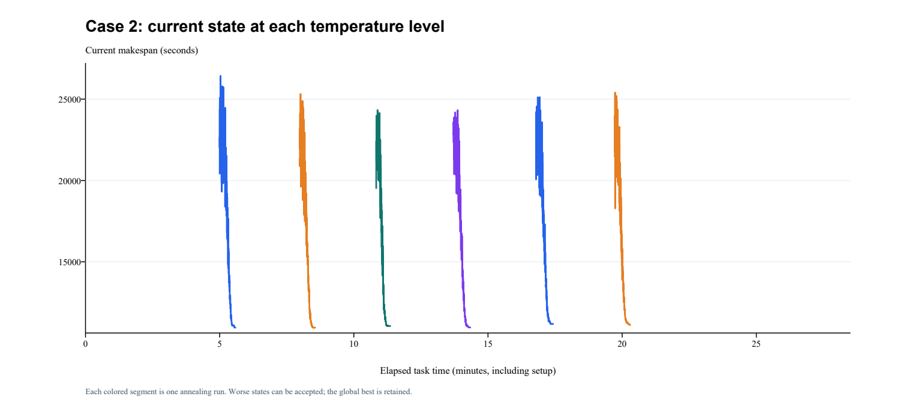
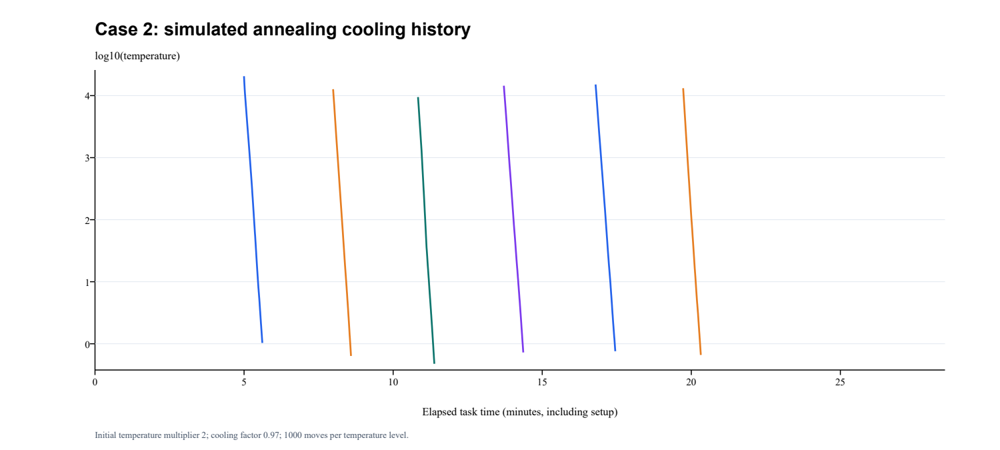

# Case 2高温长时间试跑记录（2026-10-11）

方案、温度公式和预算说明见[设计](../../../docs/实验记录/Case2长时间试跑.md)。此前10912调度作为已验证参考解保留，未重新计入本次计算成本。

本次最好可行值 **10890**，参考值10912，下降22秒。没有Case 2全局最优证明。

30分钟总任务预算包含准备和末尾验证。过程记录结束于1710.556秒；准备299.745秒，实际搜索及阶段导出约1410.811秒。另预留90秒作独立验证与曲线输出。

## 全局最好值的下降时刻

| 任务累计秒 | 实际计算累计秒 | 起点 / 阶段 | 最好值 |
| ---: | ---: | --- | ---: |
| 0 | 0 | 本次之前已有的参考解 | 10912 |
| 338.232 | 38.487 | cycle01 / gurobi | 10907 |
| 524.769 | 225.024 | cycle02 / gurobi | 10890 |

最后一次全局改善发生于任务第8.75分钟、实际计算第3.75分钟；此后1185.8秒未刷新最好值。

## 多起点逐条结果

| 起点 | 种子 | 贪心下降后 | 高温退火后 | 精确阶段后 | 初始化秒 | 退火秒 | 精确秒 | 初温 | 较差解接受数 |
| --- | ---: | ---: | ---: | ---: | ---: | ---: | ---: | ---: | ---: |
| cycle01 | 2026101101 | 10912 | 10912 | 10907 | 0.000 | 36.985 | 110.326 | 20551.793 | 69724 |
| cycle02 | 2026101114 | 11086 | 10955 | 10890 | 31.874 | 36.128 | 110.309 | 12682.419 | 62259 |
| cycle03 | 2026101127 | 11086 | 11055 | 11048 | 24.339 | 32.997 | 110.327 | 9473.722 | 57523 |
| cycle04 | 2026101140 | 11086 | 10968 | 10942 | 29.333 | 39.230 | 110.250 | 14430.173 | 64070 |
| cycle05 | 2026101153 | 11086 | 11086 | 10950 | 35.050 | 39.745 | 110.253 | 15111.349 | 65231 |
| cycle06 | 2026101166 | 11086 | 11086 | 10980 | 26.108 | 35.697 | 110.168 | 13152.968 | 62650 |

第一条起点使用已有参考解，初始化0秒不表示从零求得10912。其余起点完成自己的贪心下降、退火和精确阶段。各起点的最终值与全局保存值分别记录，较差起点不覆盖已有最好解。

## 集中改善阶段

| 阶段 | 初始区间宽度 | 精简约束 | 之前 | 之后 | 阶段秒 | 轮数 |
| --- | ---: | --- | ---: | ---: | ---: | ---: |
| focus01 | 5 | True | 10890 | 10890 | 100.284 | 48 |
| focus02 | 7 | False | 10890 | 10890 | 100.372 | 41 |
| focus03 | 9 | True | 10890 | 10890 | 100.444 | 37 |
| focus04 | 5 | False | 10890 | 10890 | 79.874 | 31 |

## 曲线与原始记录

蓝色阶梯线是全局历史最好值；橙色点表示退火改善，绿色点表示Gurobi改善。退火当前解允许上升，不能把它误读为最终最好解变差。温度图纵轴为log10，独立起点分别重新升温。另有[包含准备时间的曲线](best_curve.png)。

[实时完整事件](events.jsonl)、[CSV时间线](history.csv)、[JSON时间线](history.json)、[逐阶段汇总](summary.json)、[最终完整调度](final/result.json)、[最终甘特图](final/gantt.svg)保留。PNG另附SVG和PDF版本。

## 验证与解释范围

所有阶段仍评价完整10工位。额外复核全局最好值单调、JSONL/JSON/CSV一致、改善快照完整可行、初温倍率与降温公式、每层移动数和较差解接受数。模型、CSV/SVG、原输入和源码哈希由audit_research独立核查。36项单元测试通过。

本次同时增加了退火温度、减慢降温、增加起点和精确求解时间，不能单独把更好的结果归因于提高初温。受限范围求到OPTIMAL不证明原题全局最优。最优基准值未用于搜索、选区间或终止。

修改前备份见[清单](../../../../.backups/20261011-long-budget/manifest.json)。
